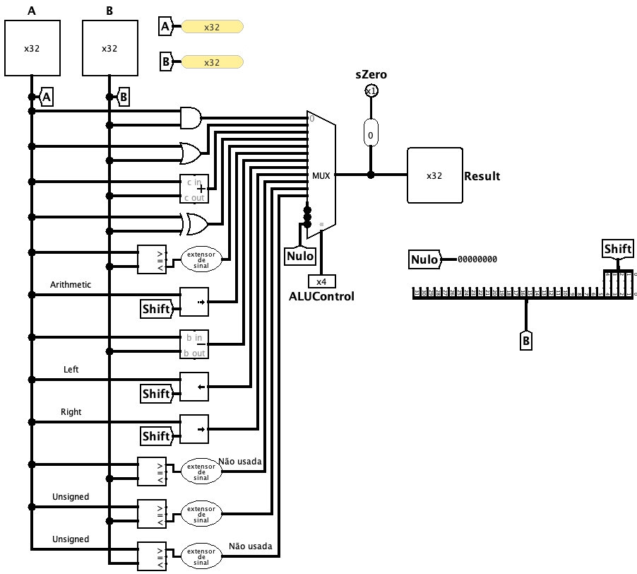

[Português](README.md) | [Español](README-es.md) | English

# Arithmetic and Logic Unit (ALU)

The arithmetic and logic unit (`ULA`) performs the processor's arithmetic and logic operations. Each cycle, it receives two 32-bit operands (`A` and `B`) and a control code (`ALUControl`) that selects the operation to perform, producing the result in `Result` and the `sZero` flag.

`ALUControl` is **3 bits wide and is the instruction's `funct3` itself**: the ALU's output multiplexer follows exactly the `funct3` order of RISC-V's `OP`/`OP-IMM` instructions (`000` = `add`/`sub`, `001` = `sll`, `010` = `slt`, …, `111` = `and`). Because `funct3` alone cannot distinguish the ISA's two ambiguous pairs (`add`/`sub` and `srl`/`sra`), the ALU receives two auxiliary 1-bit inputs — **`subSeletor`** and **`sraiSeletor`** — to distinguish the operations within each group.

It serves three main purposes:

- **Arithmetic/logic operations** for R-type and I-type instructions (`add`, `sub`, `and`, `or`, `xor`, shifts and comparisons).
- **Address calculation** for memory instructions (`lw`/`sw`), adding the base to the immediate value.
- **Branch condition evaluation** (`beq`, `bne`, `blt`, `bge`, `bltu`, `bgeu`), together with the `sZero` flag and the branch unit (`ucDesvio`).

 

## Interface

| Pin | Direction | Width | Description |
| :--- | :---: | :---: | :--- |
| `A` | Input | 32 bits | First operand (usually `rs1`). |
| `B` | Input | 32 bits | Second operand (`rs2` or an immediate value). |
| `ALUControl` | Input | 3 bits | Code selecting the operation to perform — corresponds to `funct3` (see table). |
| `subSeletor` | Input | 1 bit | Distinguishes operations in group `000`: `0` = addition (`add`), `1` = subtraction (`sub`). |
| `sraiSeletor` | Input | 1 bit | Distinguishes operations in group `101`: `0` = logical shift (`srl`), `1` = arithmetic shift (`sra`). |
| `Result` | Output | 32 bits | Result of the selected operation. |
| `sZero` | Output | 1 bit | Zero-result flag (`1` when `Result == 0`). |

The three control signals (`ALUControl`, `subSeletor` and `sraiSeletor`) are generated by controller [`ucULA`](../ucULA/README.md), using `ALUOp` (from the main control unit) and the instruction's `opcode`, `funct3` and `funct7` fields.

 

## Operation table (`ALUControl`)

| `ALUControl` (`funct3`) | Auxiliary selector | Operation | Instructions |
| :---: | :---: | :--- | :--- |
| `000` | `subSeletor = 0` | Addition (`A + B`) | `add`, `addi`, and `lw`/`sw` address calculation |
| `000` | `subSeletor = 1` | Subtraction (`A - B`) | `sub`, and `beq`/`bne` (through `sZero`) |
| `001` | — | Left shift | `sll`, `slli` |
| `010` | — | Signed less-than | `slt`, `slti`, `blt`, `bge` |
| `011` | — | Unsigned less-than | `sltu`, `sltiu`, `bltu`, `bgeu` |
| `100` | — | Logical XOR | `xor`, `xori` |
| `101` | `sraiSeletor = 0` | Logical right shift | `srl`, `srli` |
| `101` | `sraiSeletor = 1` | Arithmetic right shift | `sra`, `srai` |
| `110` | — | Logical OR | `or`, `ori` |
| `111` | — | Logical AND | `and`, `andi` |

> [!NOTE]
> Because the selector is `funct3` itself, **all eight possible codes are in use** and the output multiplexer has no idle inputs. The ALU no longer has any "unused" codes, unlike the previous 4-bit format.

 

## Operation

The ALU is **purely combinational**: it calculates **all** operations in parallel and, at the end, an **8-input multiplexer** chooses which result appears at `Result`, using the 3-bit `ALUControl` as its selector.

Before this final multiplexer, two **2-input multiplexers** distinguish the ambiguous `funct3` pairs before the result reaches the corresponding input of the main multiplexer:

- Input `000` ← multiplexer between the **adder** and **subtractor**, selected by `subSeletor`.
- Input `101` ← multiplexer between the **logical right shifter** and **arithmetic right shifter**, selected by `sraiSeletor`.

### 1. Shift amount

The three shifters do not use all of `B`: a splitter extracts the **5 least significant bits of `B`** (`B[4:0]`, internal signal `Shift`), as required by 32-bit RISC-V. Thus, shifting by `33` positions is equivalent to shifting by `1`.

### 2. Branch support

The ALU does not decide whether to take a branch on its own; it provides the comparisons used by `ucDesvio`:

- `beq`/`bne` use **subtraction** (`000` with `subSeletor = 1`): if `A - B == 0`, then `A == B`, and the `sZero` flag indicates equality.
- `blt`/`bge` use **signed less-than** (`010`).
- `bltu`/`bgeu` use **unsigned less-than** (`011`).

 

## Implementation

Internally, each operation has a dedicated block, and all block outputs converge on the final multiplexer:

- **Adder (`Adder`)** and **subtractor (`Subtractor`)** — calculate `A + B` and `A - B`; a 2-input multiplexer controlled by `subSeletor` routes one of them to input `000`.
- **Logic gates** — bitwise `XOR` (`100`), `OR` (`110`) and `AND` (`111`).
- **Shifters (`Shifter`)** — three units: left shift (`001`), logical right shift and arithmetic right shift; the last two pass through the multiplexer controlled by `sraiSeletor` before feeding input `101`.
- **Comparators (`Comparator`)** — two in total: one signed (`010`) and one unsigned (`011`), both using the *less-than* output. Each comparator passes through a **sign extender**, which converts the 1-bit result to 32 bits before it enters the multiplexer.

The **`sZero`** flag is produced by the **`zero`** subcomponent, which checks whether all 32 bits of `Result` are low. This allows `beq`/`bne` to determine equality through subtraction.
