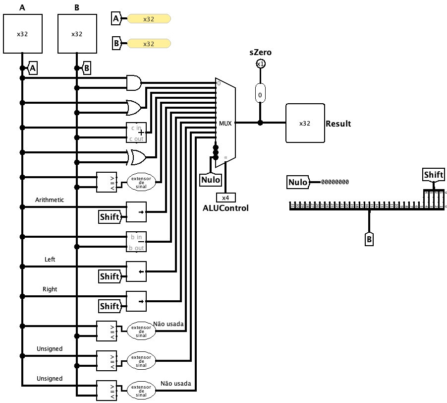

[Português](README.md) | Español | [English](README-en.md)

# Unidad Aritmética y Lógica (ALU)

La unidad aritmética y lógica (`ULA`) ejecuta las operaciones aritméticas y lógicas del procesador. En cada ciclo recibe dos operandos de 32 bits (`A` y `B`) y un código de control (`ALUControl`) que selecciona la operación que se realizará, produciendo el resultado en `Result` y el indicador `sZero`.

`ALUControl` tiene **3 bits y es el propio `funct3`** de la instrucción: el multiplexor de salida de la ALU sigue exactamente el orden de los `funct3` de las instrucciones `OP`/`OP-IMM` de RISC-V (`000` = `add`/`sub`, `001` = `sll`, `010` = `slt`, …, `111` = `and`). Como `funct3` por sí solo no distingue los dos pares ambiguos de la ISA (`add`/`sub` y `srl`/`sra`), la ALU recibe dos entradas auxiliares de 1 bit — **`subSeletor`** y **`sraiSeletor`** — que distinguen las operaciones de cada grupo.

Se utiliza para tres fines principales:

- **Operaciones aritméticas/lógicas** de las instrucciones de tipo R y tipo I (`add`, `sub`, `and`, `or`, `xor`, desplazamientos y comparaciones).
- **Cálculo de direcciones** de las instrucciones de memoria (`lw`/`sw`), sumando la base al valor inmediato.
- **Evaluación de condiciones de bifurcación** (`beq`, `bne`, `blt`, `bge`, `bltu`, `bgeu`), junto con el indicador `sZero` y la unidad de bifurcaciones (`ucDesvio`).

 

## Interfaz

| Pin | Dirección | Ancho | Descripción |
| :--- | :---: | :---: | :--- |
| `A` | Entrada | 32 bits | Primer operando (normalmente `rs1`). |
| `B` | Entrada | 32 bits | Segundo operando (`rs2` o valor inmediato). |
| `ALUControl` | Entrada | 3 bits | Código que selecciona la operación ejecutada — corresponde a `funct3` (véase la tabla). |
| `subSeletor` | Entrada | 1 bit | Distingue las operaciones del grupo `000`: `0` = suma (`add`), `1` = resta (`sub`). |
| `sraiSeletor` | Entrada | 1 bit | Distingue las operaciones del grupo `101`: `0` = desplazamiento lógico (`srl`), `1` = desplazamiento aritmético (`sra`). |
| `Result` | Salida | 32 bits | Resultado de la operación seleccionada. |
| `sZero` | Salida | 1 bit | Indicador de resultado cero (`1` cuando `Result == 0`). |

Las tres señales de control (`ALUControl`, `subSeletor` y `sraiSeletor`) las genera el controlador [`ucULA`](../ucULA/README.md), a partir de `ALUOp` (procedente de la unidad de control principal) y de los campos `opcode`, `funct3` y `funct7` de la instrucción.

 

## Tabla de operaciones (`ALUControl`)

| `ALUControl` (`funct3`) | Selector auxiliar | Operación | Instrucciones |
| :---: | :---: | :--- | :--- |
| `000` | `subSeletor = 0` | Suma (`A + B`) | `add`, `addi` y cálculo de dirección de `lw`/`sw` |
| `000` | `subSeletor = 1` | Resta (`A - B`) | `sub` y `beq`/`bne` (mediante `sZero`) |
| `001` | — | Desplazamiento a la izquierda | `sll`, `slli` |
| `010` | — | Menor que con signo | `slt`, `slti`, `blt`, `bge` |
| `011` | — | Menor que sin signo | `sltu`, `sltiu`, `bltu`, `bgeu` |
| `100` | — | XOR lógico | `xor`, `xori` |
| `101` | `sraiSeletor = 0` | Desplazamiento lógico a la derecha | `srl`, `srli` |
| `101` | `sraiSeletor = 1` | Desplazamiento aritmético a la derecha | `sra`, `srai` |
| `110` | — | OR lógico | `or`, `ori` |
| `111` | — | AND lógico | `and`, `andi` |

> [!NOTE]
> Como el selector es el propio `funct3`, **se utilizan los ocho códigos posibles** y el multiplexor de salida no tiene entradas sin utilizar. La ALU ya no tiene ningún código "sin usar", a diferencia del formato anterior de 4 bits.

 

## Funcionamiento

La ALU es **puramente combinacional**: calcula **todas** las operaciones en paralelo y, al final, un **multiplexor de 8 entradas** elige qué resultado aparece en `Result`, utilizando `ALUControl` (3 bits) como selector.

Antes de este multiplexor final hay dos **multiplexores de 2 entradas** que distinguen los pares ambiguos de `funct3` antes de que el resultado llegue a la entrada correspondiente del multiplexor principal:

- Entrada `000` ← multiplexor entre **sumador** y **restador**, seleccionado por `subSeletor`.
- Entrada `101` ← multiplexor entre **desplazador lógico a la derecha** y **desplazador aritmético a la derecha**, seleccionado por `sraiSeletor`.

### 1. Cantidad de desplazamiento

Los tres desplazadores no utilizan todo `B`: un divisor extrae los **5 bits menos significativos de `B`** (`B[4:0]`, señal interna `Shift`), como exige RISC-V de 32 bits. Así, un desplazamiento de `33` posiciones equivale a uno de `1`.

### 2. Apoyo a las bifurcaciones

La ALU no decide por sí sola si se toma una bifurcación, sino que proporciona las comparaciones que utiliza `ucDesvio`:

- `beq`/`bne` utilizan la **resta** (`000` con `subSeletor = 1`): si `A - B == 0`, entonces `A == B`, y el indicador `sZero` señala la igualdad.
- `blt`/`bge` utilizan la comparación **menor que con signo** (`010`).
- `bltu`/`bgeu` utilizan la comparación **menor que sin signo** (`011`).

 

## Implementación

Internamente, cada operación tiene un bloque dedicado y las salidas de todos ellos convergen en el multiplexor final:

- **Sumador (`Adder`)** y **restador (`Subtractor`)** — calculan `A + B` y `A - B`; un multiplexor de 2 entradas controlado por `subSeletor` envía uno de los dos resultados a la entrada `000`.
- **Puertas lógicas** — `XOR` (`100`), `OR` (`110`) y `AND` (`111`), bit a bit.
- **Desplazadores (`Shifter`)** — tres unidades: a la izquierda (`001`), lógico a la derecha y aritmético a la derecha; las dos últimas pasan por el multiplexor controlado por `sraiSeletor` antes de alimentar la entrada `101`.
- **Comparadores (`Comparator`)** — dos en total: uno con signo (`010`) y otro sin signo (`011`), ambos utilizando la salida *menor que*. Cada comparador pasa por un **extensor de signo**, que convierte el resultado de 1 bit a 32 bits antes de entrar en el multiplexor.

El indicador **`sZero`** lo produce el subcomponente **`zero`**, que comprueba si los 32 bits de `Result` están en nivel bajo. Esto permite que las instrucciones `beq`/`bne` determinen la igualdad mediante la resta.
