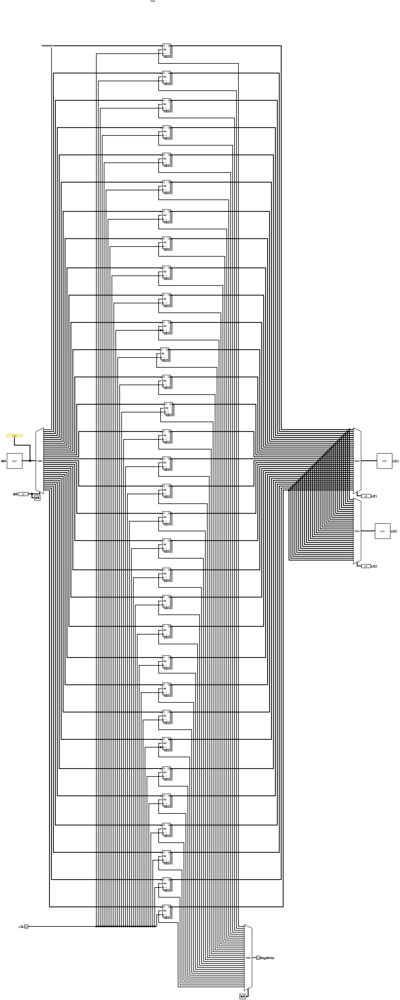

[Português](README.md) | [Español](README-es.md) | English

# Register File

The register file stores the 32 general-purpose registers (`x0` through `x31`) of the RISC-V architecture, each 32 bits wide. It provides **two independent asynchronous read ports** (to supply the ALU operands) and **one synchronous write port** (controlled by the clock), allowing the processor to read two registers and write to a third within the same cycle.

 

## Interface

| Pin | Direction | Width | Description |
| :--- | :---: | :---: | :--- |
| `LR1` | Input | 5 bits | Address of the first register to read (*read register 1*). |
| `LR2` | Input | 5 bits | Address of the second register to read (*read register 2*). |
| `WR` | Input | 5 bits | Address of the destination register for writing (*write register*). |
| `WD` | Input | 32 bits | Data to write to the destination register (*write data*). |
| `RegWrite` | Input | 1 bit | Enables writing (`1` to write, `0` to read only). |
| `clk` | Input | 1 bit | System clock signal; synchronizes the write port. |
| `LD1` | Output | 32 bits | Contents of the register addressed by `LR1` (*read data 1*). |
| `LD2` | Output | 32 bits | Contents of the register addressed by `LR2` (*read data 2*). |

 

## Operation

The register file uses combinational reads and clock-synchronized writes, as follows:

### 1. Reading (asynchronous)

Both read ports are purely combinational: the contents of all 32 registers are always available at the inputs of two **32-bit multiplexers**. Each multiplexer uses a read address as its selector:

- `LR1` selects the register routed to output `LD1`.
- `LR2` selects the register routed to output `LD2`.

Because reading does not depend on the clock, operands become available as soon as the addresses settle.

 

### 2. Writing (synchronous)

Writing occurs only on the rising edge of `clk` and only when `RegWrite = 1`. To ensure that **only the addressed register** is modified, the circuit uses address `WR` as the selector for **two demultiplexers** simultaneously:

- A **32-bit** demultiplexer routes data `WD` to the destination register's `D` input.
- A **1-bit** demultiplexer routes `RegWrite` to the same register's write-enable input (`WE`).

On the clock edge, only the register whose `WE` input is enabled captures the value of `WD`; all other registers retain their previous values.

> [!IMPORTANT]
> In the [pipelined datapath](../../datapaths/pipeline/), the [stage registers](../estagiosPipeline/) write on the **falling** edge, opposite to the register file. WB therefore writes in the middle of the cycle, and the instruction in ID during that same cycle can already read the updated value.

> [!NOTE]
> Register `x0` is fixed at zero, as required by the RISC-V specification. Reading this address always returns `0`, and attempts to write to it have no effect because its value is held constant.

 

## Implementation

The circuit is built from the following Logisim blocks:

- **Registers:** 32 units of 32 bits each, with data input `D`, output `Q`, write enable `WE` and reset `R`, all synchronized by `clk`.
- **Demultiplexers:** two blocks with a 5-bit selector (`WR`): a 32-bit block that routes `WD` to the correct register, and a 1-bit block that routes `RegWrite` to the corresponding `WE`.
- **Multiplexers:** two 32-bit blocks with 5-bit selectors (`LR1` and `LR2`), which route the selected registers' contents to outputs `LD1` and `LD2`.
- **Constant (`x0`):** a 32-bit constant with value `0` is connected to register 0's `D` input, fixing its contents at zero. Because this register's `Q` output feeds input `0` of both read multiplexers, reading address `0` always returns `0`.
- **Clock distribution:** `clk` is distributed to all 32 registers, ensuring synchronous writes throughout the register file.
