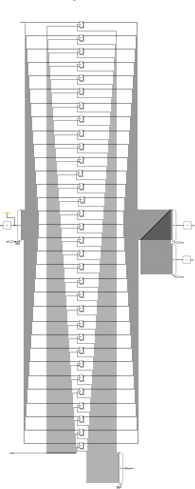

[Português](README.md) | Español | [English](README-en.md)

# Banco de registros

El Banco de Registros es el componente que almacena los 32 registros de uso general (`x0` a `x31`) de la arquitectura RISC-V, cada uno de 32 bits. Proporciona **dos puertos de lectura** independientes y asíncronos (para alimentar los operandos de la ALU) y **un puerto de escritura** síncrono (controlado por el reloj), permitiendo que el procesador lea dos registros y escriba en un tercero dentro del mismo ciclo.

 

## Interfaz

| Pin | Dirección | Ancho | Descripción |
| :--- | :---: | :---: | :--- |
| `LR1` | Entrada | 5 bits | Dirección del primer registro que se va a leer (*read register 1*). |
| `LR2` | Entrada | 5 bits | Dirección del segundo registro que se va a leer (*read register 2*). |
| `WR` | Entrada | 5 bits | Dirección del registro de destino de la escritura (*write register*). |
| `WD` | Entrada | 32 bits | Dato que se va a escribir en el registro de destino (*write data*). |
| `RegWrite` | Entrada | 1 bit | Habilita la escritura (`1` para escribir, `0` para solo leer). |
| `clk` | Entrada | 1 bit | Señal de reloj del sistema; sincroniza el puerto de escritura. |
| `LD1` | Salida | 32 bits | Contenido del registro direccionado por `LR1` (*read data 1*). |
| `LD2` | Salida | 32 bits | Contenido del registro direccionado por `LR2` (*read data 2*). |

 

## Funcionamiento

El banco opera con lecturas combinacionales y escritura sincronizada por el reloj, de la siguiente manera:

### 1. Lectura (asíncrona)
Los dos puertos de lectura son puramente combinacionales: el contenido de todos los 32 registros está siempre disponible en la entrada de dos **multiplexores** de 32 bits. Cada multiplexor utiliza una dirección de lectura como selector:
-   `LR1` selecciona qué registro se encaminará hacia la salida `LD1`.
-   `LR2` selecciona qué registro se encaminará hacia la salida `LD2`.

Como la lectura no depende del reloj, los operandos están disponibles inmediatamente después de que se estabilicen las direcciones.

 

### 2. Escritura (síncrona)
La escritura ocurre únicamente en el flanco de subida de `clk` y solo cuando `RegWrite = 1`. Para garantizar que **únicamente el registro direccionado** sea modificado, el circuito utiliza la dirección `WR` como selector de **dos demultiplexores** simultáneos:
-   Un demultiplexor de **32 bits** enruta el dato `WD` hacia la entrada `D` del registro de destino.
-   Un demultiplexor de **1 bit** enruta la señal `RegWrite` hacia la entrada de habilitación de escritura (`WE`) de ese mismo registro.

De esta forma, en el flanco de reloj, solamente el registro cuya entrada `WE` fue activada captura el valor de `WD`; todos los demás conservan su valor anterior.

> [!IMPORTANT]
> En el [_datapath_ con _pipeline_](../../datapaths/pipeline/), los [registros de etapa](../estagiosPipeline/) escriben en el flanco de **bajada**, inverso al del banco. La escritura realizada por WB ocurre, por lo tanto, a la mitad del ciclo, y la instrucción que se encuentra en ID en ese mismo ciclo ya lee el valor actualizado.

> [!NOTE]
> El registro `x0` está cableado a cero, conforme a la especificación RISC-V. Cualquier lectura de esta dirección devuelve `0` y los intentos de escritura en él no tienen efecto, ya que su valor se mantiene constante.

 

## Implementación

El circuito está construido a partir de los siguientes bloques de Logisim:

- **Registros:** 32 unidades de 32 bits, cada una con entrada de datos `D`, salida `Q`, habilitación de escritura `WE` y *reset* `R`, todas sincronizadas por `clk`.
- **Demultiplexores:** dos bloques con selector de 5 bits (`WR`) — uno de 32 bits, que dirige `WD` hacia el registro correcto, y uno de 1 bit, que dirige `RegWrite` hacia el `WE` correspondiente.
- **Multiplexores:** dos bloques de 32 bits con selector de 5 bits (`LR1` y `LR2`), responsables de encaminar el contenido de los registros elegidos hacia las salidas `LD1` y `LD2`.
- **Constante (`x0`):** una constante de 32 bits con valor `0` está conectada a la entrada `D` del registro 0, fijando su contenido en cero. Como la salida `Q` de este registro alimenta la entrada `0` de los dos multiplexores de lectura, cualquier lectura de la dirección `0` devuelve `0`.
- **Distribución de reloj:** la señal `clk` se ramifica hacia todos los 32 registros, garantizando que la escritura ocurra de forma síncrona en todo el banco.