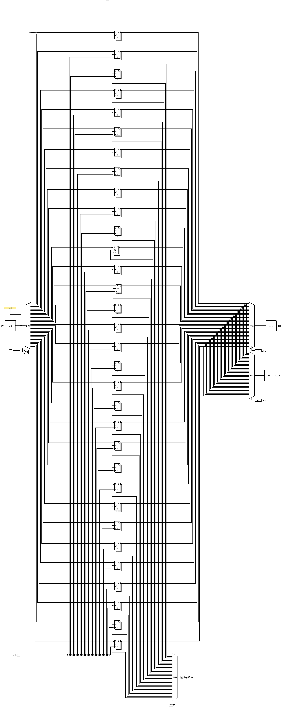

# Register bank

The Register Bank is the component that stores the 32 general-use registers (`x0` to `x31`) of the RISC-V architecture, each 32 bits wide. It provides **two independent, asynchronous read ports** (to feed the ALU operands) and **one synchronous write port** (controlled by the clock), allowing the processor to read two registers and write to a third one within the same cycle.

 

## Interface

| Pin | Direction | Width | Description |
| :--- | :---: | :---: | :--- |
| `LR1` | Input | 5 bits | Address of the first register to be read (*read register 1*). |
| `LR2` | Input | 5 bits | Address of the second register to be read (*read register 2*). |
| `WR` | Input | 5 bits | Address of the destination register for writing (*write register*). |
| `WD` | Input | 32 bits | Data to be written to the destination register (*write data*). |
| `RegWrite` | Input | 1 bit | Enables writing (`1` to write, `0` to only read). |
| `clk` | Input | 1 bit | System clock signal; synchronizes the write port. |
| `LD1` | Output | 32 bits | Content of the register addressed by `LR1` (*read data 1*). |
| `LD2` | Output | 32 bits | Content of the register addressed by `LR2` (*read data 2*). |

 

## Operation

The bank operates with combinational reads and clock-synchronized writing, as follows:

### 1. Reading (asynchronous)

The two read ports are purely combinational: the contents of all 32 registers are always available at the input of two 32-bit **multiplexers**. Each multiplexer uses a read address as a selector:

* `LR1` selects which register is routed to the `LD1` output.
* `LR2` selects which register is routed to the `LD2` output.

Since reading does not depend on the clock, the operands are available immediately after the addresses stabilize.

 

### 2. Writing (synchronous)

Writing occurs only on the rising edge of the `clk` and only when `RegWrite = 1`. To ensure that **only the addressed register** is modified, the circuit uses the `WR` address as a selector for **two simultaneous demultiplexers**:

* A **32-bit** demultiplexer routes the `WD` data to the `D` input of the destination register.
* A **1-bit** demultiplexer routes the `RegWrite` signal to the write enable (`WE`) input of that same register.

This way, on the clock edge, only the register whose `WE` input was activated captures the `WD` value; all others keep their previous values.

> [!IMPORTANT]
> In the [pipeline datapath](https://www.google.com/search?q=../../datapaths/pipeline/), the [stage registers](https://www.google.com/search?q=../pipelineStages/) write on the **falling** edge, inverse to the bank's edge. The write performed by the WB occurs, therefore, in the middle of the cycle, and the instruction that is in the ID in that same cycle already reads the updated value.

> [!NOTE]
> Register `x0` is hardwired to zero, according to the RISC-V specification. Any read from this address returns `0`, and write attempts to it have no effect, as its value is kept constant.

 

## Implementation

The circuit is built using the following Logisim blocks:

* **Registers:** 32 units of 32 bits, each with data input `D`, output `Q`, write enable `WE`, and *reset* `R`, all synchronized by the `clk`.
* **Demultiplexers:** two blocks with a 5-bit selector (`WR`) — a 32-bit one, routing `WD` to the correct register, and a 1-bit one, routing `RegWrite` to the corresponding `WE`.
* **Multiplexers:** two 32-bit blocks with a 5-bit selector (`LR1` and `LR2`), responsible for routing the chosen registers' contents to the `LD1` and `LD2` outputs.
* **Constant (`x0`):** a 32-bit constant with a value of `0` is connected to the `D` input of register 0, fixing its content to zero. Since the `Q` output of this register feeds input `0` of both read multiplexers, any read from address `0` returns `0`.
* **Clock distribution:** the `clk` signal branches out to all 32 registers, ensuring synchronous writing across the entire bank.