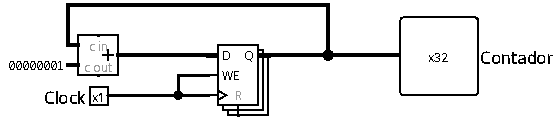

[Português](README.md) | [Español](README-es.md) | English

# Cycle Counter

The cycle counter records the total number of clock cycles elapsed while a program runs on the processor. It increments its value using combinational logic and stores the accumulated count in a sequential register.

 

## Interface

| Pin | Direction | Width | Description |
| :--- | :---: | :---: | :--- |
| `Clock` | Input | 1 bit | System clock signal (gated by the stop signal). |
| `Contador` | Output | 32 bits | Accumulated total number of executed cycles. |

 

## Operation

The module acts as a simple accumulator with feedback. While active, it increments the current count by `1` on each rising edge of the received `Clock` signal (`Contador = Contador + 1`).

### Stop mechanism

Although the counter's internal circuit is a basic accumulator, the control that freezes the count is implemented externally in the parent circuit (`main.circ`).

To pause counting when the program finishes or reaches a stop condition:

1. The main control unit (`ucPrincipal`) asserts **`Stop`** when it detects a stop instruction or an invalid opcode.
2. An external AND gate performs the operation `CLK & !Stop`.
3. When `Stop` is `1`, the AND gate's output is forced to `0`, holding the counter register's clock signal low. This prevents further updates and preserves the last count.

 

## Implementation

The circuit uses Logisim blocks for basic sequential and combinational logic:

- **Adder:** continuously adds the constant `1` to the current counter value supplied by the register.
- **Register:** stores the updated count. Its `D` input receives the adder's result, and its `Q` output feeds both the adder and the `Contador` output pin.
