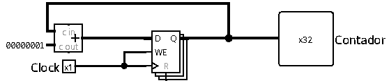

[Português](README.md) | Español | [English](README-en.md)

# Contador de Ciclos

El contador de ciclos registra la cantidad total de ciclos de reloj transcurridos durante la ejecución de un programa en el procesador. Incrementa su valor mediante lógica combinacional y almacena la cuenta acumulada en un registro secuencial.

 

## Interfaz

| Pin | Dirección | Ancho | Descripción |
| :--- | :---: | :---: | :--- |
| `Clock` | Entrada | 1 bit | Señal de reloj del sistema (controlada mediante una compuerta por la señal de parada). |
| `Contador` | Salida | 32 bits | Valor acumulado del total de ciclos ejecutados. |

 

## Funcionamiento

El módulo funciona como un acumulador simple con realimentación. Mientras está activo, en cada flanco de subida de la señal `Clock` recibida, el valor actual del contador se incrementa en `1` (`Contador = Contador + 1`).

### Mecanismo de parada

Aunque el circuito interno del contador es un acumulador básico, el control que congela la cuenta se implementa externamente en el circuito superior (`main.circ`).

Para pausar la cuenta cuando el programa termina o alcanza una condición de parada:

1. La unidad de control principal (`ucPrincipal`) activa la señal **`Stop`** al identificar una instrucción de parada o un opcode inválido.
2. Una compuerta AND externa realiza la operación `CLK & !Stop`.
3. Cuando `Stop` es `1`, la salida de la compuerta AND se fuerza a `0`, manteniendo en nivel bajo la señal de reloj que alimenta el registro del contador. Esto impide nuevas actualizaciones y conserva el último valor de la cuenta.

 

## Implementación

El circuito utiliza bloques de Logisim para lógica secuencial y combinacional básica:

- **Sumador:** suma continuamente la constante `1` al valor actual del contador procedente del registro.
- **Registro:** almacena la cuenta actualizada. Su entrada `D` recibe el resultado del sumador y su salida `Q` alimenta simultáneamente el propio sumador y el pin de salida `Contador`.
