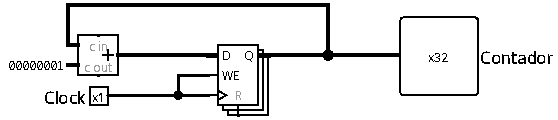

# Cycle Counter

The Cycle Counter is the component responsible for recording the total number of clock cycles elapsed during the execution of a program on the processor. It increments its value combinationally and stores the accumulated total in a sequential register.

 

## Interface

| Pin | Direction | Width | Description |
| :--- | :---: | :---: | :--- |
| `Clock` | Input | 1 bit | System clock signal (gated by the stop signal). |
| `Counter` | Output | 32 bits | Accumulated value of total executed cycles. |

 

## Operation

The module acts as a simple closed-loop accumulator. In its active state, on every rising edge of the received `Clock` signal, the current counter value is incremented by `1` (`Counter = Counter + 1`).

### Stop mechanism

Although the internal circuit of the counter is purely a basic accumulator, the count freeze control is handled externally in the top-level unit (`main.circ`).

To pause the count when the program finishes or reaches a halt condition:

1. The main control unit (`mainControlUnit`) activates the **`Stop`** signal upon identifying a halt instruction or an invalid opcode.
2. An external AND logic gate performs the operation `CLK & !Stop`.
3. When `Stop` is `1`, the output of the AND gate is forced to `0`, freezing the clock signal that feeds the counter's register. This prevents further updates and keeps the count value frozen at its last state.

 

## Implementation

To build this circuit in Logisim, blocks designed for basic sequential and combinational logic are used:

* **Adder:** a circuit that continuously adds the constant `1` to the current counter value coming from the register.
* **Register:** a component that stores the updated count. Its `D` input receives the result from the adder, and its `Q` output simultaneously feeds the adder itself and the `Counter` output pin.