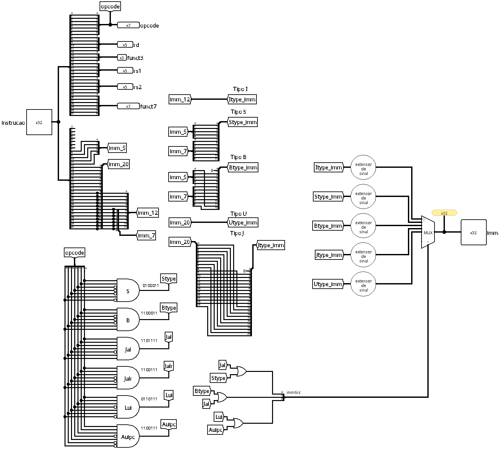

[Português](README.md) | Español | [English](README-en.md)

# Decodificador de instrucciones

El decodificador de instrucciones es el componente combinacional encargado de interpretar la instrucción de 32 bits proveniente de la memoria de instrucciones (`memInstr`), separándola en sus campos constituyentes y reconstruyendo los inmediatos necesarios para la ejecución en el *datapath*.

## Interfaz
| Pin | Dirección | Ancho | Descripción |
| --- | :---: | :---: | --- |
| `Instrucao` | Entrada | 32 bits | La instrucción bruta leída de la memoria de instrucciones. |
| `opcode` | Salida | 7 bits | Bits `[6:0]`: identifica la categoría y el formato de la instrucción. |
| `rd` | Salida | 5 bits | Bits `[11:7]`: dirección del registro de destino (donde se escribirá el resultado). |
| `funct3` | Salida | 3 bits | Bits `[14:12]`: código auxiliar de 3 bits para identificar la operación. |
| `rs1` | Salida | 5 bits | Bits `[19:15]`: dirección del primer registro fuente. |
| `rs2` | Salida | 5 bits | Bits `[24:20]`: dirección del segundo registro fuente. |
| `funct7` | Salida | 7 bits | Bits `[31:25]`: código auxiliar de 7 bits para la diferenciación fina de operaciones. |
| `Imm` | Salida | 32 bits | El valor inmediato final, reconstruido y extendido a 32 bits. |

 

## Funcionamiento
El circuito actúa de forma totalmente combinacional, dividiéndose en tres grandes bloques de responsabilidad:

### 1. Segmentación
Debido a la arquitectura RISC-V, los campos de los registros (`rs1`, `rs2` y `rd`) y los códigos de operación (`opcode`, `funct3` y `funct7`) están siempre ubicados en los mismos índices de bits, independientemente de la instrucción. El decodificador utiliza distribuidores para enrutar estas vías directamente hacia las salidas, considerando los bits descritos anteriormente.

 

### 2. Reconstrucción y extensión de los inmediatos
Cada formato de instrucción posiciona los bits del inmediato en lugares distintos; por ello, el decodificador reconstrói el inmediato de cada formato aplicando la extensión apropiada:

| Formato | Bits de la instrucción | Tratamiento y alineación | Extensor |
| :---: | :--- | :--- | :---: |
| **Tipo I** | `[31:20]` | Extensión de signo directa de 12 a 32 bits. | `extensorSinal_12` |
| **Tipo S** | `[31:25]`, `[11:7]` | Extensión de signo directa de 12 a 32 bits. | `extensorSinal_12` |
| **Tipo B** | `[31]`, `[7]`, `[30:25]`, `[11:8]` | Extensión de signo a 13 bits (bit 0 implícito en `0` para alineación de 2 bytes). | `extensorSinal_13` |
| **Tipo U** | `[31:12]` | Mantiene los 20 bits en la parte superior y rellena los 12 bits inferiores con `0`. | `extensorZero_20_typeU` |
| **Tipo J** | `[31]`, `[19:12]`, `[20]`, `[30:21]` | Extensión de signo a 21 bits (bit 0 implícito en `0` para alineación de 2 bytes). | `extensorSinal_21` |

> [!NOTE]
> Para los formatos de salto (**Tipo B** y **Tipo J**), el bit menos significativo (bit 0) se omite en la instrucción y se asume como `0`, ya que las direcciones de las instrucciones en la memoria siempre están alineadas en media palabra (2 bytes) o palabra completa (4 bytes).

 

### 3. La señal `immSrc`

El control del inmediato se realiza mediante la señal **`immSrc`** de 3 bits, que actúa como selector del multiplexor final de inmediatos.

#### Generación de `immSrc`
A partir del `opcode`, compuertas lógicas combinadas con inversores activan llaves de control internas para los formatos específicos:

| Señal Interna | Opcode | Significado / Categoría |
| :--- | :---: | :--- |
| `Stype` | `0100011` | Escritura en memoria (ej: `sw`) |
| `Btype` | `1100011` | Salto condicional (ej: `beq`, `bne`) |
| `Jal` | `1101111` | Salto incondicional relativo (`jal`) |
| `Jalr` | `1100111` | Salto incondicional indirecto (`jalr`) |
| `Lui` | `0110111` | Cargar inmediato superior (`lui`) |
| `Auipc` | `0010111` | Sumar inmediato superior al PC (`auipc`) |

Las señales anteriores son procesadas por compuertas OR y agrupadas por un distribuidor para formar el bus de 3 bits de `immSrc` `[bit2, bit1, bit0]`:
-   **`bit0`** = `Jal | Stype`
-   **`bit1`** = `Btype | Jal`
-   **`bit2`** = `Lui | Auipc`

 

#### Mapeo de selección del multiplexor
La siguiente tabla muestra la relación entre el valor lógico de `immSrc` y la salida de inmediato seleccionada:

| `immSrc` | Formato seleccionado | Entrada del Mux | Comportamiento |
| :---: | :---: | :---: | :--- |
| **`000`** | **Tipo I** / **Jalr** | Entrada 0 | Predeterminado para instrucciones aritméticas/lógicas inmediatas y de lectura de memoria (`addi`, `lw`), además de la instrucción de salto `jalr` (que utiliza un inmediato en el mismo formato que el tipo I). |
| **`001`** | **Tipo S** | Entrada 1 | Selecciona el inmediato reconstruido para escritura en memoria (`sw`). |
| **`010`** | **Tipo B** | Entrada 2 | Selecciona el inmediato reconstruido para saltos condicionales (`beq`, `bne`). |
| **`011`** | **Tipo J** | Entrada 3 | Selecciona el inmediato reconstruido para saltos largos (`jal`). |
| **`100`** | **Tipo U** | Entrada 4 | Selecciona el inmediato de 20 bits desplazado hacia arriba (`lui`, `auipc`). |
| `101` a `111` | *Reservado* | Entradas 5 a 7 | Combinaciones no utilizadas en la arquitectura RISC-V básica. |

 

## Implementación
El circuito hace uso de los siguientes bloques estructurales de Logisim:
- **Distribuidores:** usados tanto para segmentar la instrucción bruta de entrada como para recombinar los bits dispersos de los inmediatos de los formatos S, B, J y U.
- **Compuertas lógicas (AND, NOT, OR):** responsables de decodificar el `opcode` de 7 bits y mapear las señales internas para generar el selector `immSrc`.
- **Multiplexor de datos:** módulo controlado por `immSrc` que encamina el inmediato correcto hacia la salida `Imm`.