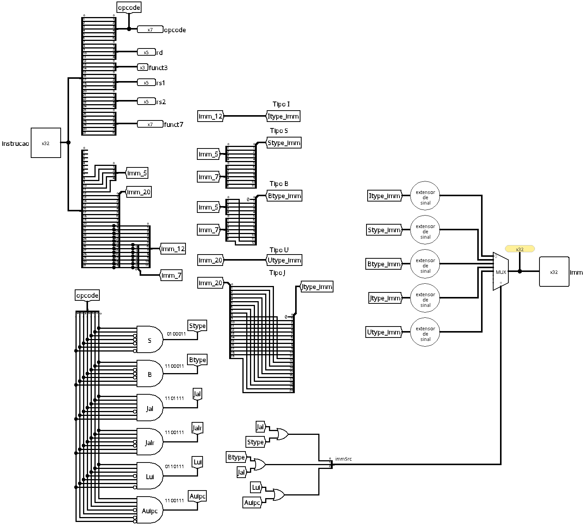

# Instruction Decoder

The instruction decoder is the combinational component in charge of interpreting the 32-bit instruction coming from the instruction memory (`memInstr`), separating it into its constituent fields and reconstructing the immediates necessary for execution in the *datapath*.

## Interface

| Pin | Direction | Width | Description |
| :--- | :---: | :---: | :--- |
| `Instruction` | Input | 32 bits | The raw instruction read from the instruction memory. |
| `opcode` | Output | 7 bits | Bits `[6:0]`: identifies the category and format of the instruction. |
| `rd` | Output | 5 bits | Bits `[11:7]`: destination register address (where the result will be written). |
| `funct3` | Output | 3 bits | Bits `[14:12]`: 3-bit auxiliary code to identify the operation. |
| `rs1` | Output | 5 bits | Bits `[19:15]`: address of the first source register. |
| `rs2` | Output | 5 bits | Bits `[24:20]`: address of the second source register. |
| `funct7` | Output | 7 bits | Bits `[31:25]`: 7-bit auxiliary code for fine differentiation of operations. |
| `Imm` | Output | 32 bits | The final immediate value, reconstructed and extended to 32 bits. |

 

## Operation

The circuit acts in a completely combinational way, being divided into three main blocks of responsibility:

### 1. Slicing

Due to the RISC-V architecture, the register fields (`rs1`, `rs2`, and `rd`) and the operation codes (`opcode`, `funct3`, and `funct7`) are always located at the same bit indices, regardless of the instruction. The decoder uses splitters to route these paths directly to the outputs, considering the bits described above.

 

### 2. Immediate reconstruction and extension

Each instruction format places the immediate bits in different locations, so the decoder reconstructs the immediate for each format by applying the appropriate extension:

| Format | Instruction bits | Treatment and alignment | Extender |
| :---: | :--- | :--- | :---: |
| **Type I** | `[31:20]` | Direct sign extension from 12 to 32 bits. | `signExtender_12` |
| **Type S** | `[31:25]`, `[11:7]` | Direct sign extension from 12 to 32 bits. | `signExtender_12` |
| **Type B** | `[31]`, `[7]`, `[30:25]`, `[11:8]` | Sign extension to 13 bits (implicit bit 0 at `0` for 2-byte alignment). | `signExtender_13` |
| **Type U** | `[31:12]` | Keeps the 20 bits in the upper part and fills the lower 12 bits with `0`. | `zeroExtender_20_typeU` |
| **Type J** | `[31]`, `[19:12]`, `[20]`, `[30:21]` | Sign extension to 21 bits (implicit bit 0 at `0` for 2-byte alignment). | `signExtender_21` |

> [!NOTE]
> For branch and jump formats (**Type B** and **Type J**), the least significant bit (bit 0) is omitted in the instruction and assumed to be `0`, since instruction addresses in memory are always half-word (2 bytes) or full-word (4 bytes) aligned.

 

### 3. The `immSrc` signal

Immediate control is handled by the 3-bit **`immSrc`** signal, which acts as the selector for the final immediate multiplexer.

#### `immSrc` generation

Based on the `opcode`, logic gates combined with inverters activate internal control switches for specific formats:

| Internal Signal | Opcode | Meaning / Category |
| :--- | :---: | :--- |
| `Stype` | `0100011` | Memory write (e.g., `sw`) |
| `Btype` | `1100011` | Conditional branch (e.g., `beq`, `bne`) |
| `Jal` | `1101111` | Relative unconditional jump (`jal`) |
| `Jalr` | `1100111` | Indirect unconditional jump (`jalr`) |
| `Lui` | `0110111` | Load upper immediate (`lui`) |
| `Auipc` | `0010111` | Add upper immediate to PC (`auipc`) |

The above signals are processed by OR gates and grouped by a splitter to form the 3-bit `immSrc` bus `[bit2, bit1, bit0]`:

* **`bit0`** = `Jal | Stype`
* **`bit1`** = `Btype | Jal`
* **`bit2`** = `Lui | Auipc`

 

#### Multiplexer selection mapping

The table below shows the relationship between the logical value of `immSrc` and the selected immediate output:

| `immSrc` | Selected format | Mux Input | Behavior |
| :---: | :---: | :---: | :--- |
| **`000`** | **Type I** / **Jalr** | Input 0 | Default for immediate arithmetic/logic and memory read instructions (`addi`, `lw`), as well as the `jalr` jump instruction (which uses an immediate in the same format as type I). |
| **`001`** | **Type S** | Input 1 | Selects the reconstructed immediate for memory writing (`sw`). |
| **`010`** | **Type B** | Input 2 | Selects the reconstructed immediate for branches (`beq`, `bne`). |
| **`011`** | **Type J** | Input 3 | Selects the reconstructed immediate for long jumps (`jal`). |
| **`100`** | **Type U** | Input 4 | Selects the 20-bit immediate shifted upwards (`lui`, `auipc`). |
| `101` to `111` | *Reserved* | Inputs 5 to 7 | Combinations not used in the basic RISC-V architecture. |

 

## Implementation

The circuit uses the following Logisim structural blocks:

* **Splitters:** used both to segment the raw input instruction and to recombine the scattered immediate bits of the S, B, J, and U formats.
* **Logic gates (AND, NOT, OR):** responsible for decoding the 7-bit `opcode` and mapping the internal signals to generate the `immSrc` selector.
* **Data multiplexer:** module driven by `immSrc` that routes the correct immediate to the `Imm` output.