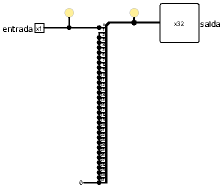
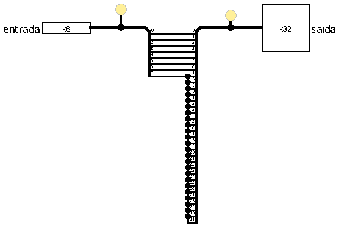
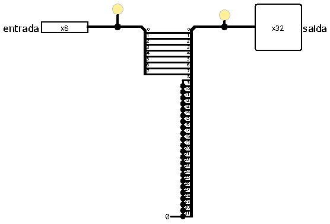
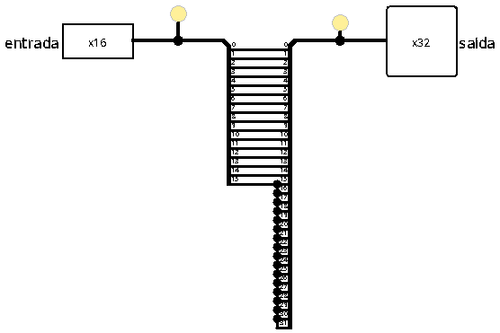
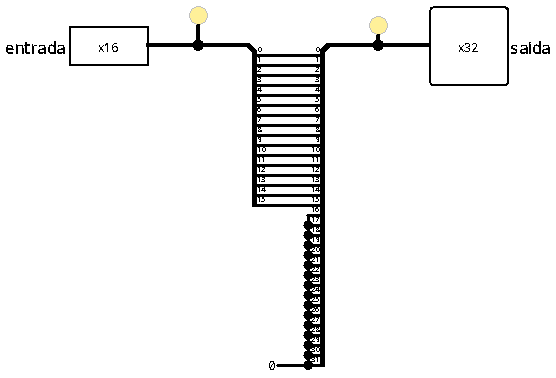
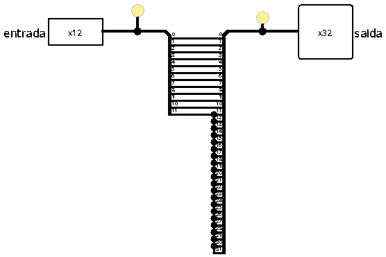
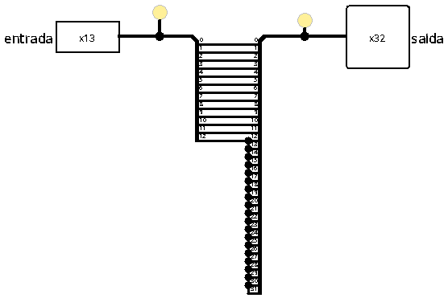
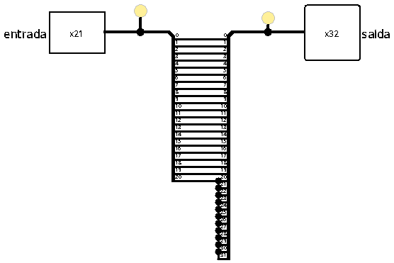
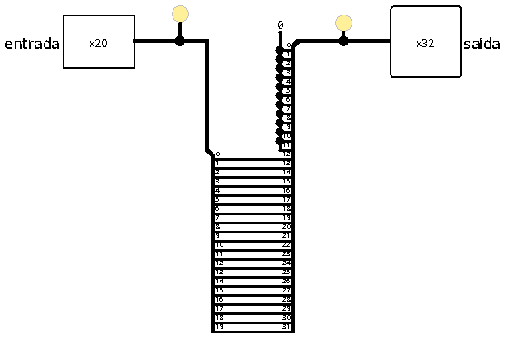

[Português](README.md) | Español (Coming soon) | English

# Sign and zero extenders

In a 32-bit architecture (such as RISC-V), the internal registers and the Arithmetic Logic Unit (ALU) operate exclusively with 32-bit data buses. However, many instructions contain smaller immediate values (1, 12, 13, 20, or 21 bits) or manipulate data coming from memory in smaller portions (8-bit bytes or 16-bit half-words).

The **Sign and Zero Extenders** are the blocks responsible for matching these smaller data widths, expanding them to the standard 32-bit format before the data enters the ALU or is written into a register.

 

## Fundamental concepts

To understand and replicate these circuits, it is crucial to differentiate the two types of arithmetic extension:

### 1. Sign extension

Used for signed integer numbers (represented in two's complement). The circuit identifies the most significant bit (MSB) of the input data, which indicates the number's sign (0 for positive, 1 for negative), and replicates it across all new positions to the left until completing 32 bits. This guarantees that both the numerical value and its original sign are mathematically preserved.

**Example (4 bits to 8 bits):**
-   **Positive:** `0101` (5) $\rightarrow$ The sign bit is `0` $\rightarrow$ Extends to `00000101` (5).
-   **Negative:** `1101` (-3) $\rightarrow$ The sign bit is `1` $\rightarrow$ Extends to `11111101` (-3).

 

### 2. Zero extension

Used for unsigned or logical values. The circuit ignores the input data's sign and simply fills all new positions to the left with a low logic level (`0`).

**Example (4 bits to 8 bits):**
-   **Value:** `1101` (13 in unsigned decimal) $\rightarrow$ Extends to `00001101` (13).

 

## Modules summary table

All extenders below are implemented in the `extensoresSinal.circ` file. The following table describes each module, its width, and its application:

| Module | Input | Output | Extension Type | Main Application |
| :--- | :---: | :---: | :---: | :--- |
| `extensorSinal_1` | 1 bit | 32 bits | Sign (MSB) | Converts logical flags into 32-bit data to be written into a register (`slt`). |
| `extensorSinal_8` | 8 bits | 32 bits | Sign (MSB) | Sign extension for byte loads (`lb`). |
| `extensorZero_8` | 8 bits | 32 bits | Zero (`0`) | Zero extension for unsigned byte loads (`lbu`). |
| `extensorSinal_12` | 12 bits | 32 bits | Sign (MSB) | Extension of I-Type (`addi`, `lw`, `jalr`) and S-Type (`sw`) immediates. |
| `extensorSinal_13` | 13 bits | 32 bits | Sign (MSB) | Extension of B-Type conditional branch immediates (`beq`, `bne`). |
| `extensorSinal_16` | 16 bits | 32 bits | Sign (MSB) | Sign extension for half-word loads (`lh`). |
| `extensorZero_16` | 16 bits | 32 bits | Zero (`0`) | Zero extension for unsigned half-word loads (`lhu`). |
| `extensorZero_20_typeU` | 20 bits | 32 bits | Upper Alignment | Places the U-Type immediate in the upper 20 bits and fills the lower 12 bits with `0` (`lui`, `auipc`). |
| `extensorSinal_21` | 21 bits | 32 bits | Sign (MSB) | Extension of J-Type unconditional jump immediates (`jal`). |

 

## Interface and operation

All components follow the same principle: the input bus is sliced by a splitter, and the 32-bit output lines are wired so that the lower positions receive the original data and the upper positions receive either the most significant bit of the data (sign extension) or a zero constant (zero extension).

### 1. 1-bit sign extender (`extensorSinal_1`)

Converts the single input bit into 32 identical bits at the output (either all `0` or all `1`).

 

### 2. Memory data extenders (`extensorSinal_8`, `extensorZero_8`, `extensorSinal_16`, `extensorZero_16`)

Used in memory data load instructions with 8-bit (byte) or 16-bit (half-word) widths.
-   **With sign extension:** replicate the sign bit of the original data (`bit 7` for 8 bits and `bit 15` for 16 bits) to maintain the correct representation of negative values.
-   **With zero extension:** fill the remaining upper bits with `0`, ignoring any sign.

| Sign Extender (8 and 16 bits) | Zero Extender (8 and 16 bits) |
| :---: | :---: |
|  |  |
|  |  |

 

### 3. Decoder immediate extenders (`extensorSinal_12`, `extensorSinal_13`, `extensorSinal_21`)
Used in the decoder to form 32-bit immediates:
-   **`extensorSinal_12`:** extends the 12-bit input to 32 bits by replicating `bit 11`.
-   **`extensorSinal_13` (B-Type):** receives the 13-bit immediate (whose `bit 0` was already filled with `0` during reconstruction) and replicates `bit 12`.
-   **`extensorSinal_21` (J-Type):** receives the 21-bit immediate (whose `bit 0` was already filled with `0` during reconstruction) and replicates `bit 20`.

| 12-bit Sign Extender | 13-bit Sign Extender | 21-bit Sign Extender |
| :---: | :---: | :---: |
|  |  |  |

 

### 4. Upper alignment extender (`extensorZero_20_typeU`)
This extender is exclusive to U-Type instructions (`lui` and `auipc`). Instead of extending bits to the left (most significant positions), it inserts **12 zero bits to the right** (least significant positions `[11:0]`), pushing the 20-bit input to the upper part of the 32-bit word (`[31:12]`).

 

## Implementation
The circuits make use of the following Logisim structural blocks:
- **Splitters:** used both to split the bits from the input bus and to expand and connect them to the output positions of the 32-bit bus.
- **Constants:** used to inject a low logic level (`0`) into the unoccupied positions in the zero and upper alignment (U-Type) extenders.