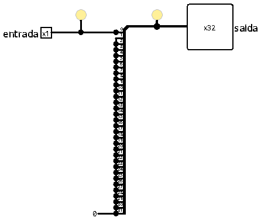
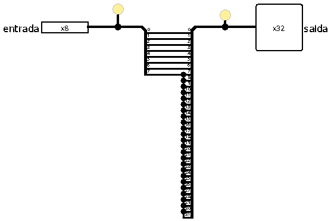
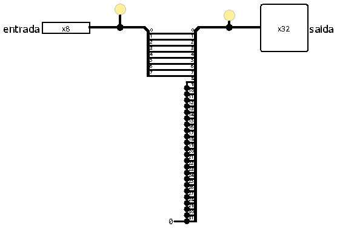
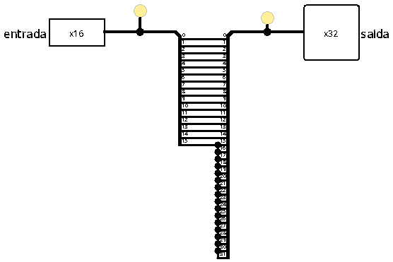
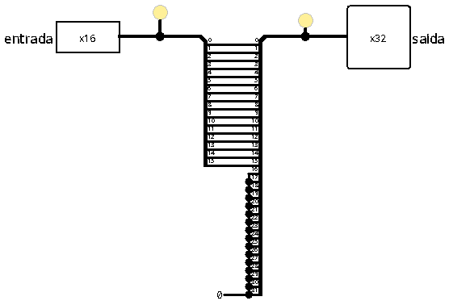
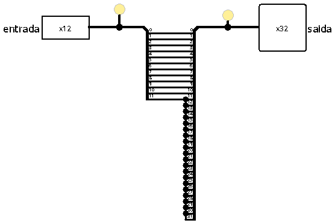
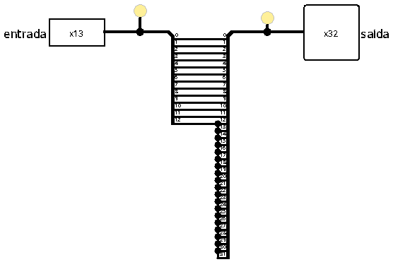
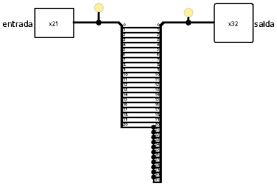
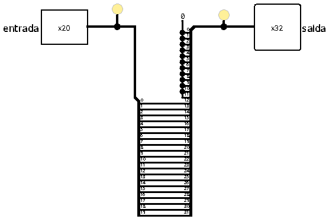

[Português](README.md) | Español | [English](README-en.md)

# Extensores de signo y de cero

En una arquitectura de 32 bits (como la de RISC-V), los registros internos y la Unidad Lógica y Aritmética (ALU) operan exclusivamente con buses de datos de 32 bits. Sin embargo, muchas instrucciones contienen valores inmediatos menores (de 1, 12, 13, 20 o 21 bits) o manipulan datos provenientes de la memoria en porciones menores (bytes de 8 bits o medias palabras de 16 bits).

Los **Extensores de Signo y de Cero** son los bloques responsables de compatibilizar estos anchos de datos menores, expandiéndolos al formato estándar de 32 bits antes de que el dato entre en la ALU o se escriba en un registro.

 

## Conceptos fundamentales

Para comprender y replicar estos circuitos, es crucial diferenciar los dos tipos de extensión aritmética:

### 1. Extensión de signo (*Sign Extension*)
Utilizada para números enteros con signo (representados en complemento a 2). El circuito identifica el bit más significativo (MSB) del dato de entrada, que indica el signo del número (0 para positivo, 1 para negativo), y lo replica por todas las nuevas posiciones a la izquierda hasta completar 32 bits. Esto garantiza que el valor numérico y su signo original se preserven matemáticamente.

**Ejemplo (4 bits a 8 bits):**
-   **Positivo:** `0101` (5) $\rightarrow$ El bit de signo es `0` $\rightarrow$ Se extiende a `00000101` (5).
-   **Negativo:** `1101` (-3) $\rightarrow$ El bit de signo es `1` $\rightarrow$ Se extiende a `11111101` (-3).

 

### 2. Extensión de cero (*Zero Extension*)
Utilizada para valores sin signo (*unsigned*) o lógicos. El circuito ignora el signo del dato de entrada y simplemente rellena todas las nuevas posiciones a la izquierda con el nivel lógico bajo (`0`).

**Ejemplo (4 bits a 8 bits):**
-   **Valor:** `1101` (13 en decimal sin signo) $\rightarrow$ Se extiende a `00001101` (13).

 

## Tabla resumen de los módulos

Todos los extensores a continuación están implementados en el archivo `extensoresSinal.circ`. La siguiente tabla describe cada módulo, su ancho y su aplicación:

| Módulo | Entrada | Salida | Tipo de Extensión | Aplicación Principal |
| :--- | :---: | :---: | :---: | :--- |
| `extensorSinal_1` | 1 bit | 32 bits | Signo (MSB) | Convierte *flags* lógicas en datos de 32 bits para escritura en registro (`slt`). |
| `extensorSinal_8` | 8 bits | 32 bits | Signo (MSB) | Extensión de signo para lectura de byte (`lb`). |
| `extensorZero_8` | 8 bits | 32 bits | Cero (`0`) | Extensión de cero para lectura de byte sin signo (`lbu`). |
| `extensorSinal_12` | 12 bits | 32 bits | Signo (MSB) | Extensión de inmediatos de Tipo I (`addi`, `lw`, `jalr`) y Tipo S (`sw`). |
| `extensorSinal_13` | 13 bits | 32 bits | Signo (MSB) | Extensión de inmediatos de saltos condicionales Tipo B (`beq`, `bne`). |
| `extensorSinal_16` | 16 bits | 32 bits | Signo (MSB) | Extensión de signo para lectura de media palabra (`lh`). |
| `extensorZero_16` | 16 bits | 32 bits | Cero (`0`) | Extensión de cero para lectura de media palabra sin signo (`lhu`). |
| `extensorZero_20_typeU` | 20 bits | 32 bits | Alineación Superior | Posiciona el inmediato de Tipo U en los 20 bits superiores y rellena los 12 bits inferiores con `0` (`lui`, `auipc`). |
| `extensorSinal_21` | 21 bits | 32 bits | Signo (MSB) | Extensión de inmediatos de saltos incondicionales Tipo J (`jal`). |

 

## Interfaz y funcionamiento

Todos los componentes siguen el mismo principio: la vía de entrada es segmentada por un distribuidor, y las vías de salida de 32 bits se conectan de modo que las posiciones inferiores reciban el dato original y las posiciones superiores reciban o el bit más significativo del dato (extensión de signo) o una constante cero (extensión de cero).

### 1. Extensor de signo de 1 bit (`extensorSinal_1`)
Convierte el bit único de entrada en 32 bits idénticos en la salida (o todos `0` o todos `1`).

 

### 2. Extensores de datos de memoria (`extensorSinal_8`, `extensorZero_8`, `extensorSinal_16`, `extensorZero_16`)
Usados en las instrucciones de lectura (*load*) de datos de la memoria con anchos de 8 bits (byte) o 16 bits (half-word).
-   **Con extensión de signo:** replican el bit de signo del dato original (`bit 7` en el caso de 8 bits y `bit 15` en el caso de 16 bits) para mantener la representación correcta de valores negativos.
-   **Con extensión de cero:** rellenan los bits superiores restantes con `0`, ignorando cualquier signo.

| Extensor de Signo (8 y 16 bits) | Extensor de Cero (8 y 16 bits) |
| :---: | :---: |
|  |  |
|  |  |

 

### 3. Extensores de inmediatos del decodificador (`extensorSinal_12`, `extensorSinal_13`, `extensorSinal_21`)
Utilizados en el decodificador para formar los inmediatos de 32 bits:
-   **`extensorSinal_12`:** extiende la entrada de 12 bits a 32 bits replicando el `bit 11`.
-   **`extensorSinal_13` (Tipo B):** recibe el inmediato de 13 bits (cuyo `bit 0` ya fue rellenado con `0` en la reconstrucción) y replica el `bit 12`.
-   **`extensorSinal_21` (Tipo J):** recibe el inmediato de 21 bits (cuyo `bit 0` ya fue rellenado con `0` en la reconstrucción) y replica el `bit 20`.

| Extensor de Signo de 12 bits | Extensor de Signo de 13 bits | Extensor de Signo de 21 bits |
| :---: | :---: | :---: |
|  |  |  |

 

### 4. Extensor de alineación superior (`extensorZero_20_typeU`)
Este extensor es exclusivo para instrucciones de Tipo U (`lui` y `auipc`). En lugar de extender bits a la izquierda (posiciones más significativas), inserta **12 bits cero a la derecha** (posiciones menos significativas `[11:0]`), empujando la entrada de 20 bits hacia la parte superior de la palabra de 32 bits (`[31:12]`).

 

## Implementación
Los circuitos hacen uso de los siguientes bloques estructurales de Logisim:
- **Distribuidores:** usados tanto para segmentar los bits del bus de entrada como para expandirlos y conectarlos en las posiciones de salida del bus de 32 bits.
- **Constantes:** utilizadas para inyectar el nivel lógico bajo (`0`) en las posiciones no ocupadas en los extensores de cero y de alineación superior (Tipo U).
