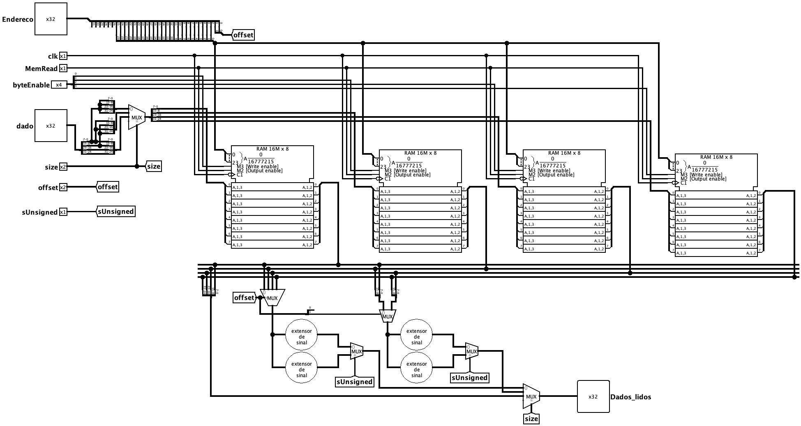

[Português](README.md) | Español (Coming soon) | English

# Data memory

The Data Memory is the component that stores and retrieves data manipulated by the program during execution (the processor's *load*/*store* region). It is accessed by load instructions (`lw`, `lh`, `lb`, `lhu`, `lbu`) and store instructions (`sw`, `sh`, `sb`), supporting **word (32-bit)**, **half-word (16-bit)**, and **byte (8-bit)** accesses, both signed and unsigned.

To allow access with different granularities, the memory is organized into **four 8-bit banks** (one per byte of the word), making it possible to write only the desired bytes without modifying the others.

 

## Interface

| Pin | Direction | Width | Description |
| :--- | :---: | :---: | :--- |
| `Endereco` | Input | 32 bits | Memory address to be accessed (read or write). |
| `dado` | Input | 32 bits | Data to be written in store instructions (*store*). |
| `MemRead` | Input | 1 bit | Enables memory reading (*output enable*). |
| `byteEnable` | Input | 4 bits | Selects which of the four byte banks will be written to, enabling `sb`, `sh`, and `sw`. |
| `size` | Input | 2 bits | Access size: byte, half-word, or word. |
| `offset` | Input | 2 bits | Data offset within the word (which byte/half-word is being accessed). |
| `sUnsigned` | Input | 1 bit | Defines the read extension (`0` for sign extension, `1` for zero extension). |
| `clk` | Input | 1 bit | Clock signal that synchronizes memory writes. |
| `Dados_lidos` | Output | 32 bits | Data read from memory, already aligned and extended to 32 bits. |

 

## Operation

The circuit separates access into two operations: writing, which is synchronous with the clock, and reading, which is combinational. The input address is sliced to provide both the word address sent to the banks and the byte `offset` within it.

### 1. Write (*store*)
To write data, the circuit uses the `dado` input and the `byteEnable`, `offset`, and `clk` controls:
-   The 32-bit data is distributed across the four byte banks; a multiplexer controlled by `size` adjusts the forwarded byte pattern according to the access size.
-   The `byteEnable` signal (4 bits) — already aligned by the `offset` in the addressing control unit — individually activates the *write enable* of each of the four byte banks. Thus, `sb` enables only one bank, `sh` enables two, and `sw` enables all four, placing the data in the correct position within the word.
-   The actual write occurs on the clock edge, only in the enabled banks; the others retain their previous content.

 

### 2. Read (*load*)
Reading is combinational and enabled by `MemRead`. All four banks deliver their bytes simultaneously, and the circuit assembles the output in three stages:
-   **Slice selection:** based on the `offset`, multiplexers choose which byte or half-word from the read word will be used.
-   **Extension:** the selected slice passes through the appropriate extenders (`extensorSinal_8`/`extensorSinal_16` for signed values and `extensorZero_8`/`extensorZero_16` for unsigned values). The `sUnsigned` signal selects, in each pair, which extension is forwarded.
-   **Size selection:** finally, a multiplexer controlled by `size` chooses between the byte, half-word, or full word result, delivering the final value at `Dados_lidos`.

> [!NOTE]
> The distinction between sign and zero extension is what differentiates, for example, `lb` from `lbu` and `lh` from `lhu`. With `sUnsigned = 0`, the most significant bit of the data is replicated (preserving negative values); with `sUnsigned = 1`, the upper positions are filled with `0`.

 

## Implementation

The circuit is built from the following Logisim blocks:

- **RAM Memories:** four `RAM 16M x 8` blocks (8-bit data, 24-bit address, rising-edge clock write), each representing a byte bank of the 32-bit word.
- **Splitters:** slice the input address (separating the word address from the `offset`) and split/recombine the 32-bit data into its four individual bytes.
- **Multiplexers:** align the write data according to the `offset` and, during reads, select the correct slice (`offset`), the desired extension (`sUnsigned`), and the final access size (`size`).
- **Extenders:** `extensorSinal_8`, `extensorZero_8`, `extensorSinal_16`, and `extensorZero_16` modules, imported from `../extensores/extensoresSinal.circ`, responsible for expanding bytes and half-words to 32 bits.