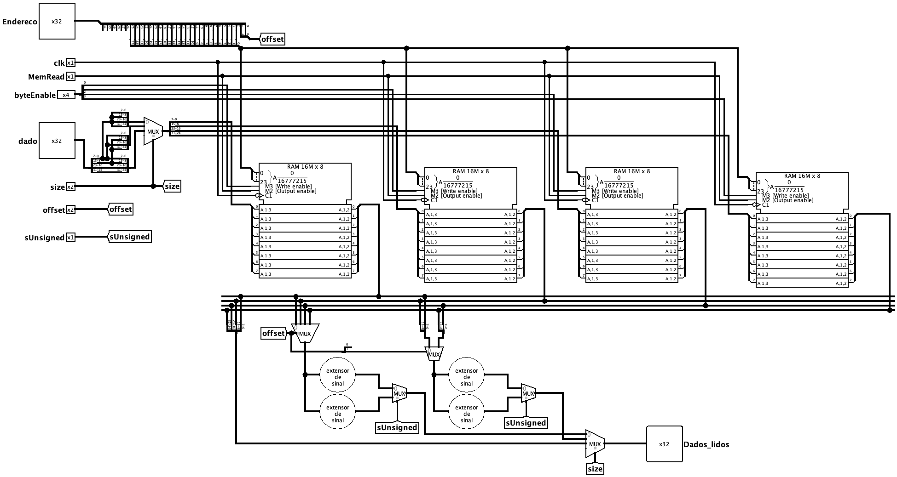

[Português](README.md) | Español | [English](README-en.md)

# Memoria de datos

La Memoria de Datos es el componente que almacena y recupera los datos manipulados por el programa durante la ejecución (la región de *load*/*store* del procesador). Es accedida por las instrucciones de lectura (`lw`, `lh`, `lb`, `lhu`, `lbu`) y de escritura (`sw`, `sh`, `sb`), ofreciendo soporte a accesos de **palabra (32 bits)**, **media palabra (16 bits)** y **byte (8 bits)**, tanto con signo como sin signo.

Para permitir el acceso con diferentes granularidades, la memoria está organizada en **cuatro bancos de 8 bits** (uno por byte de la palabra), lo que posibilita escribir únicamente los bytes deseados sin alterar los demás.

 

## Interfaz

| Pin | Dirección | Ancho | Descripción |
| :--- | :---: | :---: | :--- |
| `Endereco` | Entrada | 32 bits | Dirección de memoria que se va a acceder (lectura o escritura). |
| `dado` | Entrada | 32 bits | Dato que se va a grabar en las instrucciones de escritura (*store*). |
| `MemRead` | Entrada | 1 bit | Habilita la lectura de la memoria (*output enable*). |
| `byteEnable` | Entrada | 4 bits | Selecciona cuáles de los cuatro bancos de byte serán escritos, permitiendo `sb`, `sh` y `sw`. |
| `size` | Entrada | 2 bits | Tamaño del acceso: byte, media palabra o palabra. |
| `offset` | Entrada | 2 bits | Desplazamiento del dato dentro de la palabra (qué byte/media palabra se está accediendo). |
| `sUnsigned` | Entrada | 1 bit | Define la extensión de la lectura (`0` para extensión de signo, `1` para extensión de cero). |
| `clk` | Entrada | 1 bit | Señal de reloj que sincroniza la escritura en la memoria. |
| `Dados_lidos` | Salida | 32 bits | Dato leído de la memoria, ya alineado y extendido a 32 bits. |

 

## Funcionamiento

El circuito separa el acceso en dos operaciones: la escritura, síncrona con el reloj, y la lectura, combinacional. La dirección de entrada se segmenta para proporcionar tanto la dirección de palabra enviada a los bancos como el `offset` de byte dentro de ella.

### 1. Escritura (*store*)
Para grabar datos, el circuito utiliza la entrada `dado` y los controles `byteEnable`, `offset` y `clk`:
-   El dato de 32 bits se distribuye hacia los cuatro bancos de byte; un multiplexor controlado por `size` ajusta el patrón de bytes encaminado según el tamaño del acceso.
-   La señal `byteEnable` (4 bits) — ya alineada por el `offset` en la unidad de control de direccionamiento — activa individualmente el *write enable* de cada uno de los cuatro bancos de byte. Así, `sb` habilita solo un banco, `sh` habilita dos y `sw` habilita los cuatro, haciendo que el dato caiga en la posición correcta de la palabra.
-   La grabación efectiva ocurre en el flanco de reloj, únicamente en los bancos habilitados; los demás mantienen su contenido anterior.

 

### 2. Lectura (*load*)
La lectura es combinacional y está habilitada por `MemRead`. Los cuatro bancos entregan sus bytes simultáneamente, y el circuito ensambla la salida en tres etapas:
-   **Selección del tramo:** con base en el `offset`, multiplexores eligen qué byte o media palabra de la palabra leída será usado.
-   **Extensión:** el tramo seleccionado pasa por los extensores apropiados (`extensorSinal_8`/`extensorSinal_16` para valores con signo y `extensorZero_8`/`extensorZero_16` para valores sin signo). La señal `sUnsigned` selecciona, en cada par, qué extensión se encamina.
-   **Selección del tamaño:** finalmente, un multiplexor controlado por `size` elige entre el resultado de byte, de media palabra o de la palabra completa, entregando el valor final en `Dados_lidos`.

> [!NOTE]
> La distinción entre extensión de signo y de cero es lo que diferencia, por ejemplo, `lb` de `lbu` y `lh` de `lhu`. Con `sUnsigned = 0`, el bit más significativo del dato se replica (preservando valores negativos); con `sUnsigned = 1`, las posiciones superiores se rellenan con `0`.

 

## Implementación

El circuito está construido a partir de los siguientes bloques de Logisim:

- **Memorias RAM:** cuatro bloques `RAM 16M x 8` (8 bits de dato, 24 bits de dirección, grabación en el flanco de subida del reloj), cada uno representando un banco de byte de la palabra de 32 bits.
- **Distribuidores (*splitters*):** segmentan la dirección de entrada (separando la dirección de palabra del `offset`) y dividen/recombinan el dato de 32 bits en sus cuatro bytes individuales.
- **Multiplexores:** alinean el dato de escritura según el `offset` y, en la lectura, seleccionan el tramo correcto (`offset`), la extensión deseada (`sUnsigned`) y el tamaño final del acceso (`size`).
- **Extensores:** módulos `extensorSinal_8`, `extensorZero_8`, `extensorSinal_16` y `extensorZero_16`, importados de `../Extensores/extensoresSinal.circ`, responsables de expandir bytes y medias palabras a 32 bits.