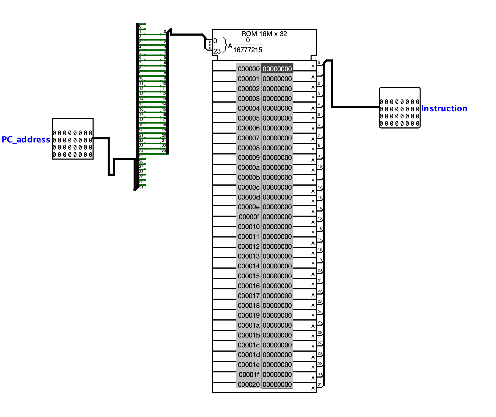

[Português](README.md) | Español (Coming soon) | English

# Instruction memory

The Instruction Memory is the component that stores the program to be executed by the processor. On each cycle, it receives the address of the next instruction from the program counter (`PC_address`) and returns the corresponding 32-bit instruction (`Instruction`), which will be interpreted by the decoder and the control unit.

Because it is a read-only memory (*ROM*), its content remains fixed during execution: the circuit only queries the addressed location without ever writing to it.

 

## Interface

| Pin | Direction | Width | Description |
| :--- | :---: | :---: | :--- |
| `PC_address` | Input | 32 bits | Address of the instruction to be fetched, provided by the program counter (PC). |
| `Instruction` | Output | 32 bits | 32-bit instruction stored at the addressed location. |

 

## Operation

The circuit operates in a purely combinational manner: given a stable address at `PC_address`, the corresponding instruction appears immediately at `Instruction`.

### 1. Address alignment
Since each instruction occupies a 4-byte word, instruction addresses are always multiples of 4. Therefore, the circuit discards the 2 least significant bits of `PC_address` and uses the next 24 bits as the ROM word address. This conversion (division by 4) ensures that advancing the PC by 4 bytes corresponds to advancing exactly one position in memory.

 

### 2. Instruction fetch
The 24-bit address selects one of the ROM locations, whose 32-bit content is forwarded directly to the `Instruction` output. There is no write control or enable signal: reading is always active.

> [!NOTE]
> The content of the ROM represents the program in machine language. It is preloaded into memory (in hexadecimal) and remains fixed throughout the simulation, as this is the processor's **read-only** memory.

 

## Implementation

The circuit is built from the following Logisim blocks:

- **ROM Memory:** a `ROM 16M x 32` block (24-bit address and 32-bit data), which stores the program instructions and delivers the addressed word at the output.
- **Splitter:** slices the 32-bit `PC_address`, discarding the 2 least significant bits and routing the 24 word-address bits to the ROM input.