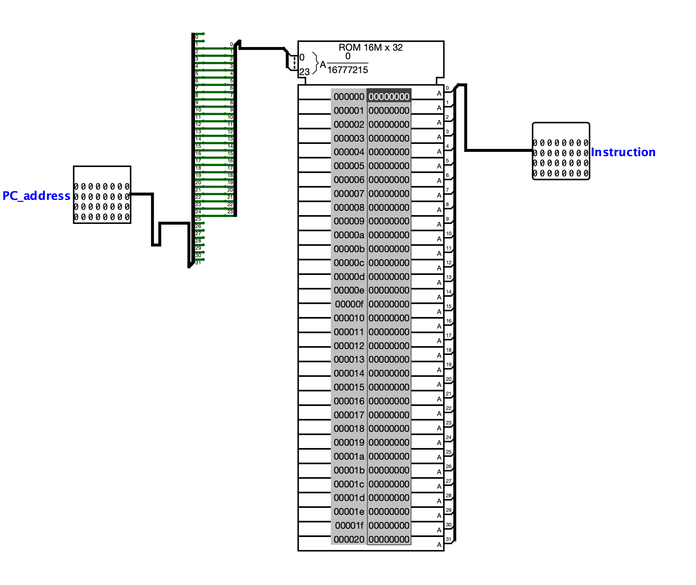

[Português](README.md) | Español | [English](README-en.md)

# Memoria de instrucciones

La Memoria de Instrucciones es el componente que almacena el programa que será ejecutado por el procesador. En cada ciclo, recibe la dirección de la siguiente instrucción proveniente del contador de programa (`PC_address`) y devuelve la instrucción de 32 bits correspondiente (`Instruction`), que será interpretada por el decodificador y por la unidad de control.

Al ser una memoria de solo lectura (*ROM*), su contenido permanece fijo durante la ejecución: el circuito únicamente consulta la posición direccionada, sin escribir nunca sobre ella.

 

## Interfaz

| Pin | Dirección | Ancho | Descripción |
| :--- | :---: | :---: | :--- |
| `PC_address` | Entrada | 32 bits | Dirección de la instrucción que se va a buscar, proporcionada por el contador de programa (PC). |
| `Instruction` | Salida | 32 bits | Instrucción de 32 bits almacenada en la posición direccionada. |

 

## Funcionamiento

El circuito actúa de forma puramente combinacional: dada una dirección estable en `PC_address`, la instrucción correspondiente aparece inmediatamente en `Instruction`.

### 1. Alineación de la dirección
Como cada instrucción ocupa una palabra de 4 bytes, las direcciones de instrucción son siempre múltiplos de 4. Por ello, el circuito descarta los 2 bits menos significativos de `PC_address` y utiliza los 24 bits siguientes como dirección de palabra de la ROM. Esta conversión (división por 4) hace que avanzar el PC en 4 bytes corresponda a avanzar exactamente una posición en la memoria.

 

### 2. Lectura de la instrucción
La dirección de 24 bits selecciona una de las posiciones de la ROM, cuyo contenido de 32 bits se encamina directamente hacia la salida `Instruction`. No hay control de escritura ni señal de habilitación: la lectura está siempre activa.

> [!NOTE]
> El contenido de la ROM representa el programa en lenguaje de máquina. Se carga previamente en la memoria (en hexadecimal) y permanece fijo durante toda la simulación, ya que esta es la memoria de **solo lectura** del procesador.

 

## Implementación

El circuito está construido a partir de los siguientes bloques de Logisim:

- **Memoria ROM:** bloque `ROM 16M x 32` (dirección de 24 bits y dato de 32 bits), que almacena las instrucciones del programa y entrega la palabra direccionada en la salida.
- **Distribuidor (*splitter*):** segmenta el `PC_address` de 32 bits, descartando los 2 bits menos significativos y enrutando los 24 bits de dirección de palabra hacia la entrada de la ROM.