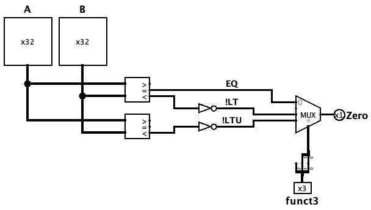

[Português](README.md) | Español (Coming soon) | English

# Branch mini-ALU (idULA)

The Branch Mini-ALU (`idULA`) is the component responsible for performing, in the *Instruction Decode* (ID) stage, the comparisons required for conditional branch decision-making. By operating directly on the register file output values (`rs1` and `rs2`), it moves branch resolution earlier to the ID stage, **reducing hazards and bubbles** in the pipeline.

It takes over, exclusively for branches, the role previously played by the `ucULA` + `ULA` pair in the execution stage (EX). Therefore, it **does not** perform result arithmetic (addition, subtraction, shifts): it only performs **comparisons**, delivering a single `Zero` output compatible with the existing `ucDesvio`.

 

## Interface

| Pin | Direction | Width | Description |
| :--- | :---: | :---: | :--- |
| `A` | Input | 32 bits | First operand (`rs1`, coming from the register file). |
| `B` | Input | 32 bits | Second operand (`rs2`; branches are B-Type, never immediate). |
| `funct3` | Input | 3 bits | Instruction field; selects which comparison feeds `Zero`. |
| `Zero` | Output | 1 bit | Result of the selected comparison, delivered directly to `ucDesvio`. |

 

## Comparison table by instruction

The table below shows which primitive comparison each branch uses and how the signal travels through `idULA` and `ucDesvio` until the final decision:

| Instr | Concept (taken when) | Mux receives | `ucDesvio` applies | Final result |
| :--- | :--- | :---: | :--- | :--- |
| **beq**  | `EQ=1`  | `EQ`   | direct | `EQ` |
| **bne**  | `EQ=0`  | `EQ`   | NOT    | `!EQ` |
| **blt**  | `LT=1`  | `!LT`  | NOT    | `!(!LT) = LT` |
| **bge**  | `LT=0`  | `!LT`  | direct | `!LT` |
| **bltu** | `LTU=1` | `!LTU` | NOT    | `!(!LTU) = LTU` |
| **bgeu** | `LTU=0` | `!LTU` | direct | `!LTU` |

> `EQ` goes **directly** into the mux, whereas `LT` and `LTU` enter **negated**. This reproduces the convention already expected by `ucDesvio` (inherited from the previous ALU, where the `Zero` flag from the `slt` comparison meant "not less than"). The double negation — `!LT` at the mux and the `NOT` bubble in `ucDesvio` — cancels out, resulting in the correct behavior.

 

## Mux selection table (`funct3`)

The multiplexer selector is built from the bits `funct3[2]` (high bit) and `funct3[1]` (low bit):

| Instr | `funct3` | `funct3[2]` | `funct3[1]` | Selector | Mux input | `Zero` outputs = |
| :--- | :---: | :---: | :---: | :---: | :---: | :---: |
| **beq**  | `000` | 0 | 0 | `00` | 0 | `EQ` |
| **bne**  | `001` | 0 | 0 | `00` | 0 | `EQ` |
| **blt**  | `100` | 1 | 0 | `10` | 2 | `!LT` |
| **bge**  | `101` | 1 | 0 | `10` | 2 | `!LT` |
| **bltu** | `110` | 1 | 1 | `11` | 3 | `!LTU` |
| **bgeu** | `111` | 1 | 1 | `11` | 3 | `!LTU` |

> `funct3[0]` **does not** enter the mux — it is the bit that differentiates each pair (beq/bne, blt/bge, bltu/bgeu) and is used solely by `ucDesvio` to invert the polarity. Therefore, mux input `1` (selector `01`) is never selected: there is no branch instruction with `funct3[2:1] = 01`.

 

## Operation

The `idULA` is **purely combinational** and operates in four stages for each instruction passing through ID:

### 1. Operand input
The register file delivers `rs1` and `rs2`, which simultaneously feed both comparators (at inputs `A` and `B`).

### 2. Continuous comparison
The comparators compute **all** results at all times, regardless of the instruction:
-   `EQ`  — `rs1 == rs2`
-   `LT`  — `rs1 < rs2` (signed)
-   `LTU` — `rs1 < rs2` (unsigned)

### 3. Selection by `funct3`
The multiplexer, controlled by `funct3[2:1]`, chooses which comparison (`EQ`, `!LT`, or `!LTU`) becomes the `Zero` output. The others are ignored during that cycle.

### 4. Branch decision
The `Zero` output is delivered to `ucDesvio`, which — without any modification — applies the polarity via `funct3[0]` and produces `BranchSrc`.

> The **signed** × **unsigned** distinction is essential: for negative operands, `LT` and `LTU` diverge (e.g., `-1` is the smallest signed value, but the largest unsigned value). That is why **both** comparators are required; equality (`EQ`), being identical in both modes, is taken from only one of them.

 

## Implementation

The `idULA` is built from the following blocks:

- **Signed comparator** (`2's Complement`, 32 bits) — provides `EQ` (`=` output) and `LT` (`<` output).
- **Unsigned comparator** (`Unsigned`, 32 bits) — provides `LTU` (`<` output); its `=` and `>` outputs are unused.
- **Inverters (`NOT`)** — applied to the `LT` and `LTU` lines before the mux, generating `!LT` and `!LTU`.
- **4→1 Multiplexer** — 2-bit selector (`funct3[2]`, `funct3[1]`); inputs `0 = EQ`, `2 = !LT`, `3 = !LTU`; input `1` is grounded to `0` (never selected).
- **Splitter** — splits the 3-bit `funct3` to assemble the mux selector.

> [!NOTE]
> With equality (`EQ`) resolved by `idULA`, the **main ALU in the EX stage no longer needs the `sZero` output** nor the `zero` subcomponent.