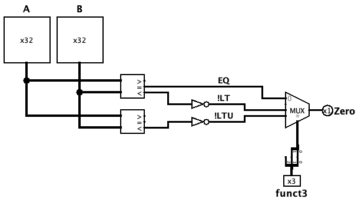

[Português](README.md) | Español | [English](README-en.md)

# Mini-ALU de salto (idULA)

La Mini-ALU de Salto (`idULA`) es el componente responsable de realizar, en la etapa de *Instruction Decode* (ID), las comparaciones necesarias para la toma de decisiones de los saltos condicionales (*branches*). Al operar directamente sobre los valores de salida del banco de registros (`rs1` y `rs2`), anticipa la resolución del salto a la etapa ID, **reduciendo conflictos y burbujas** en el pipeline.

Asume, únicamente para los saltos, el papel que antes desempeñaba la dupla `ucULA` + `ULA` en la etapa de ejecución (EX). Por ello, **no** realiza aritmética de resultado (suma, resta, desplazamientos): hace solamente **comparaciones**, entregando una única salida `Zero` compatible con la `ucDesvio` ya existente.

 

## Interfaz

| Pin | Dirección | Ancho | Descripción |
| :--- | :---: | :---: | :--- |
| `A` | Entrada | 32 bits | Primer operando (`rs1`, proveniente del banco de registros). |
| `B` | Entrada | 32 bits | Segundo operando (`rs2`; los saltos son Tipo-B, nunca inmediato). |
| `funct3` | Entrada | 3 bits | Campo de la instrucción; selecciona qué comparación alimenta a `Zero`. |
| `Zero` | Salida | 1 bit | Resultado de la comparación seleccionada, entregado directamente a `ucDesvio`. |

 

## Tabla de comparaciones por instrucción

La siguiente tabla muestra qué comparación primitiva utiliza cada salto y cómo la señal atraviesa la `idULA` y la `ucDesvio` hasta la decisión final:

| Instr | Concepto (taken cuando) | Mux recibe | `ucDesvio` aplica | Resultado final |
| :--- | :--- | :---: | :--- | :--- |
| **beq**  | `EQ=1`  | `EQ`   | directo | `EQ` |
| **bne**  | `EQ=0`  | `EQ`   | NOT     | `!EQ` |
| **blt**  | `LT=1`  | `!LT`  | NOT     | `!(!LT) = LT` |
| **bge**  | `LT=0`  | `!LT`  | directo | `!LT` |
| **bltu** | `LTU=1` | `!LTU` | NOT     | `!(!LTU) = LTU` |
| **bgeu** | `LTU=0` | `!LTU` | directo | `!LTU` |

> El `EQ` entra **directo** en el mux, pero `LT` y `LTU` entran **negados**. Esto reproduce la convención que `ucDesvio` ya espera (heredada de la ALU antigua, donde el `Zero` de la comparación `slt` significaba "no es menor"). La doble negación — `!LT` en el mux y la burbuja `NOT` en `ucDesvio` — se cancela, resultando en el comportamiento correcto.

 

## Tabla de selección del mux (`funct3`)

El selector del multiplexor se ensambla con los bits `funct3[2]` (bit alto) y `funct3[1]` (bit bajo):

| Instr | `funct3` | `funct3[2]` | `funct3[1]` | Selector | Entrada del mux | `Zero` sale = |
| :--- | :---: | :---: | :---: | :---: | :---: | :---: |
| **beq**  | `000` | 0 | 0 | `00` | 0 | `EQ` |
| **bne**  | `001` | 0 | 0 | `00` | 0 | `EQ` |
| **blt**  | `100` | 1 | 0 | `10` | 2 | `!LT` |
| **bge**  | `101` | 1 | 0 | `10` | 2 | `!LT` |
| **bltu** | `110` | 1 | 1 | `11` | 3 | `!LTU` |
| **bgeu** | `111` | 1 | 1 | `11` | 3 | `!LTU` |

> El `funct3[0]` **no** entra en el mux — es el bit que diferencia cada par (beq/bne, blt/bge, bltu/bgeu) y es usado únicamente por `ucDesvio` para invertir la polaridad. Por eso la entrada `1` del mux (selector `01`) nunca es seleccionada: no existe salto con `funct3[2:1] = 01`.

 

## Funcionamiento

La `idULA` es **puramente combinacional** y opera en cuatro etapas en cada instrucción que pasa por ID:

### 1. Entrada de los operandos
El banco de registros entrega `rs1` y `rs2`, que alimentan simultáneamente a los dos comparadores (en las entradas `A` y `B`).

### 2. Comparación continua
Los comparadores calculan **todas** las respuestas todo el tiempo, independientemente de la instrucción:
-   `EQ`  — `rs1 == rs2`
-   `LT`  — `rs1 < rs2` (con signo)
-   `LTU` — `rs1 < rs2` (sin signo)

### 3. Selección por `funct3`
El multiplexor, controlado por `funct3[2:1]`, elige qué comparación (`EQ`, `!LT` o `!LTU`) se convierte en la salida `Zero`. Las demás son ignoradas en ese ciclo.

### 4. Decisión del salto
La salida `Zero` se entrega a `ucDesvio`, que — sin ninguna alteración — aplica la polaridad mediante `funct3[0]` y produce `BranchSrc`.

> La distinción **con signo** × **sin signo** es esencial: para operandos negativos, `LT` y `LTU` divergen (ej.: `-1` es el menor valor con signo, pero el mayor sin signo). Por eso los **dos** comparadores son necesarios; la igualdad (`EQ`), por ser idéntica en ambos modos, se toma de solo uno.

 

## Implementación

La `idULA` está construida por los siguientes bloques:

- **Comparador con signo** (`2's Complement`, 32 bits) — proporciona `EQ` (salida `=`) y `LT` (salida `<`).
- **Comparador sin signo** (`Unsigned`, 32 bits) — proporciona `LTU` (salida `<`); sus salidas `=` y `>` no se usan.
- **Inversores (`NOT`)** — aplicados a las líneas `LT` y `LTU` antes del mux, generando `!LT` y `!LTU`.
- **Multiplexor 4→1** — selector de 2 bits (`funct3[2]`, `funct3[1]`); entradas `0 = EQ`, `2 = !LT`, `3 = !LTU`; la entrada `1` está conectada a tierra en `0` (nunca seleccionada).
- **Splitter** — separa el `funct3` de 3 bits para ensamblar el selector del mux.

> [!NOTE]
> Con la igualdad (`EQ`) resuelta por la `idULA`, la **ALU principal de EX ya no necesita la salida `sZero`** ni el subcomponente `zero`.