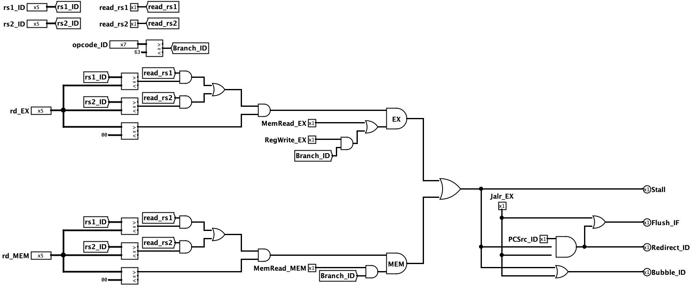

# Unidade de Detecção de Conflitos (ucConflitos)



A Unidade de Detecção de Conflitos (`ucConflitos`) é a _hazard detection unit_ descrita por Patterson e Hennessy, na versão que trabalha junto com a [Unidade de Encaminhamento](../ucEncaminhamento/) no [`pipelineEncaminhamentoBolhas`](../../../datapaths/pipelineEncaminhamentoBolhas/). Ela pausa o _pipeline_ (insere uma bolha) **somente** quando o valor de que a instrução no ID precisa ainda não foi calculado em nenhum estágio, ou seja, quando o encaminhamento não consegue resolver o conflito. Também gera os sinais que descartam e redirecionam as instruções nos desvios e saltos.

Ela deriva da [`hazard_detection_unit`](../hazard_detection_unit/hazard_detection_unit.circ) do [`pipeline_bubble`](../../../datapaths/pipeline_bubble/). Aquele _datapath_ não tem encaminhamento, então a unidade dele pausa em **toda** dependência com uma instrução no EX ou no MEM. Aqui a pausa fica restrita aos três casos que o encaminhamento não cobre. A parte de desvios (`Redirect_ID`, `Flush_IF` e `Bubble_ID`) é a mesma.

<br>

## Interface

| Pino | Direção | Largura | Descrição |
| :--- | :---: | :---: | :--- |
| `read_rs1` | Entrada | 1 bit | A instrução no ID realmente lê `rs1` (vem da [`control_unit_bubble`](../../ucPrincipal/control_unit_bubble.circ)). |
| `read_rs2` | Entrada | 1 bit | A instrução no ID realmente lê `rs2`. |
| `rd_EX` | Entrada | 5 bits | Registrador de destino da instrução no EX. |
| `RegWrite_EX` | Entrada | 1 bit | A instrução no EX escreve no banco. |
| `rd_MEM` | Entrada | 5 bits | Registrador de destino da instrução no MEM. |
| `MemRead_MEM` | Entrada | 1 bit | A instrução no MEM é um _load_. **Nova**, no lugar de `RegWrite_MEM`. |
| `rs1_ID` | Entrada | 5 bits | Primeiro registrador lido pela instrução no ID. |
| `rs2_ID` | Entrada | 5 bits | Segundo registrador lido pela instrução no ID. |
| `Jalr_EX` | Entrada | 1 bit | A instrução no EX é um `jalr` (o alvo sai da ULA neste ciclo). |
| `MemRead_EX` | Entrada | 1 bit | A instrução no EX é um _load_. **Nova**. |
| `PCSrc_ID` | Entrada | 1 bit | O ID quer redirecionar o `PC` para `PC_ID + imm_ID` (desvio tomado ou `jal`). |
| `opcode_ID` | Entrada | 7 bits | `opcode` da instrução no ID; `1100011` identifica um desvio condicional (`Branch_ID`). **Nova**. |
| `Stall` | Saída | 1 bit | Pausa: congela o `PC` e o `IF/ID` e coloca uma bolha no `ID/EX`. |
| `Redirect_ID` | Saída | 1 bit | Seleciona `PC_ID + imm_ID` como próximo `PC`. |
| `Flush_IF` | Saída | 1 bit | Troca a instrução que entra no `IF/ID` por um `nop`. |
| `Bubble_ID` | Saída | 1 bit | Troca a instrução que entra no `ID/EX` por uma bolha (entrada `Clear` do [`estagioID_EX_bolha`](../../estagiosPipeline/estagioID_EX_bolha/)). |

O bloco é o mesmo da `hazard_detection_unit` (título _Hazard Detection Unit_, portas de 20 em 20 e as mesmas posições), para a unidade ocupar o mesmo lugar no _datapath_. As mudanças são só as necessárias: a porta `RW_MEM` virou `MemRead_MEM` e o bloco ficou 40 px mais alto para receber `MemRead_EX` e `opcode_ID`, com `PCSrc_ID` descendo para depois de `MemRead_EX`. As saídas não mudaram de lugar.

<br>

## Funcionamento

### Quando o _pipeline_ para
Com o encaminhamento, a instrução no ID só precisa esperar quando o valor que ela vai ler **ainda não existe** no momento em que ela o usa:

```
usaEX  = rd_EX  ≠ 0  e  ((read_rs1 e rs1_ID = rd_EX)  ou  (read_rs2 e rs2_ID = rd_EX))
usaMEM = rd_MEM ≠ 0  e  ((read_rs1 e rs1_ID = rd_MEM) ou  (read_rs2 e rs2_ID = rd_MEM))

Branch_ID = (opcode_ID = 1100011)

Stall = usaEX  e MemRead_EX                         (load seguido de uso)
     ou usaEX  e RegWrite_EX e Branch_ID             (escrita seguida de desvio)
     ou usaMEM e MemRead_MEM e Branch_ID             (load seguido de desvio, 2ª bolha)
```

| Caso | Por que o encaminhamento não basta | Bolhas |
| :--- | :--- | :---: |
| _Load_ no EX e a instrução no ID usa o resultado | O dado só sai da memória no fim do MEM; no ciclo seguinte ele já pode ser encaminhado do `MEM/WB` para o EX. É a condição do livro (seção 4.7, _Data Hazards and Stalls_). | 1 |
| Instrução que escreve no EX e desvio condicional no ID que lê o resultado | O desvio compara os operandos no ID, no mesmo ciclo em que a ULA ainda calcula o valor. Um ciclo depois, o valor está no `EX/MEM` e é encaminhado para a `idULA`. | 1 |
| _Load_ no MEM e desvio condicional no ID que lê o resultado | O dado só existe no fim do MEM. Junto com a bolha do caso anterior (o _load_ também tem `RegWrite`), o desvio espera dois ciclos e recebe o valor do `MEM/WB`. | 2 |

Os dois casos de desvio são os descritos no livro na seção 4.8 (_Control Hazards_), ao antecipar a decisão do desvio para o ID: "um ciclo de pausa depois de uma instrução de ULA, dois depois de um _load_".

Todo o resto é resolvido pelo encaminhamento, sem bolha: uma instrução de ULA seguida de outra que usa o resultado no EX, o dado ou a base de um _store_, a base de um `jalr`, e qualquer dependência com uma instrução no MEM que não seja _load_.

O `jalr` não é um desvio condicional (`opcode` `1100111`, então `Branch_ID = 0`): ele lê `rs1` no EX, onde o alvo é calculado pela ULA. Por isso só a regra do _load_ vale para ele.

### Por que `read_rs1` e `read_rs2`
O livro compara `rs1` e `rs2` sem saber se a instrução os lê de verdade. Em `lui`, `auipc`, `jal`, nos _loads_ e no tipo I, esses campos são parte do imediato e podem coincidir com um `rd` por acaso, gerando uma pausa desnecessária. Os sinais `read_rs1`/`read_rs2`, gerados pela unidade de controle, eliminam essas dependências falsas (ver a tabela no [`pipeline_bubble`](../../../datapaths/pipeline_bubble/README.md#estágio-id---decodificação-e-controle)).

### Desvios e saltos
A parte de controle dos desvios é igual à da `hazard_detection_unit`:

```
Redirect_ID = PCSrc_ID e não Stall e não Jalr_EX
Flush_IF    = Redirect_ID ou Jalr_EX
Bubble_ID   = Stall ou Jalr_EX
```

- **Desvio tomado ou `jal` no ID:** o `PC` vai para o alvo e a instrução buscada é descartada (`Flush_IF`): 1 bolha.
- **Desvio que ainda espera um operando:** `Stall` impede o redirecionamento até o valor ficar pronto.
- **`jalr` no EX:** o `PC` recebe o alvo da ULA e as instruções no IF e no ID são descartadas (`Flush_IF` e `Bubble_ID`): 2 bolhas. O `jalr` tem prioridade sobre o redirecionamento do ID e sobre a pausa: o `PC` e o `IF/ID` avançam mesmo com `Stall = 1`.

<br>

## Implementação

O circuito é o da `hazard_detection_unit`, com a condição de pausa trocada:

- **Comparação com o EX e com o MEM** — para cada estágio, dois **Comparadores** de 5 bits (`rs1_ID` e `rs2_ID` contra o `rd`), duas portas **AND** com `read_rs1`/`read_rs2`, uma **OR** e uma **AND** com a saída `>` de um terceiro Comparador (`rd > 0`, ou seja, `rd ≠ 0`). O resultado é `usaEX` ou `usaMEM`.
- **Desvio no ID** — um **Comparador** de 7 bits compara `opcode_ID` com a constante `0x63` (`1100011`) e gera o túnel interno `Branch_ID`. A unidade de controle até tem uma saída `Branch`, mas ela fica do outro lado da unidade de controle, sem caminho livre até a unidade no _datapath_; o `opcode` já passa logo abaixo do bloco.
- **Condição do EX** — uma porta **AND** (`RegWrite_EX` e `Branch_ID`) e uma **OR** com `MemRead_EX`, ligadas à porta **AND** `EX`.
- **Condição do MEM** — uma porta **AND** (`MemRead_MEM` e `Branch_ID`), ligada à porta **AND** `MEM`.
- **Saídas** — uma **OR** junta `EX` e `MEM` em `Stall`; uma **AND** de 3 entradas (`PCSrc_ID` e as negações de `Stall` e `Jalr_EX`) gera `Redirect_ID`, e duas **OR** geram `Flush_IF` e `Bubble_ID`.

`Branch_ID`, `rs1_ID`, `rs2_ID`, `read_rs1` e `read_rs2` chegam aos dois blocos de comparação por túneis. O restante do circuito é o da `hazard_detection_unit`; a parte da direita (portas `EX`/`MEM` e saídas) foi deslocada para abrir espaço para as portas novas.

> [!NOTE]
> A unidade foi verificada com 26.736 vetores de teste (`-w ucConflitos`): todas as combinações com registradores entre `x0` e `x2` (com `opcode` de desvio e de tipo R) e mais 6.000 combinações aleatórias com os 32 registradores e vários `opcode`s.
