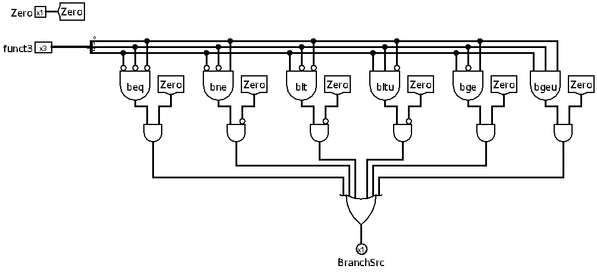

[Português](README.md) | Español (Coming soon) | English

# Branch control unit

The Branch Control Unit (`ucDesvio`) is the component in charge of evaluating whether conditional branch conditions have been satisfied. It analyzes the comparison flag generated by the ALU and the instruction's `funct3` field, determining whether the program flow should take the conditional branch.

 

## Interface

| Pin | Direction | Width | Description |
| :--- | :---: | :---: | :--- |
| `Zero` | Input | 1 bit | Equality/comparison flag coming from the ALU. |
| `funct3` | Input | 3 bits | Instruction field that identifies the branch comparison type. |
| `BranchSrc` | Output | 1 bit | Indicates whether the branch condition was met (`1`) or not (`0`). |

 

## Condition mapping table

The table below describes how the `funct3` field is decoded to verify the respective condition through the `Zero` signal generated by the ALU:

| funct3 | Instruction | Comparison | Branch condition |
| :---: | :--- | :---: | :---: |
| `000` | `beq` (Branch Equal) | `A == B` (via subtraction) | `Zero == 1` |
| `001` | `bne` (Branch Not Equal) | `A != B` (via subtraction) | `Zero == 0` |
| `100` | `blt` (Branch Less Than) | `A < B` (signed) | `Zero == 0` |
| `101` | `bge` (Branch Greater or Equal) | `A >= B` (signed) | `Zero == 1` |
| `110` | `bltu` (Branch Less Than *Unsigned*) | `A < B` (unsigned) | `Zero == 0` |
| `111` | `bgeu` (Branch Greater or Equal *Unsigned*) | `A >= B` (unsigned) | `Zero == 1` |

 

## Operation

The branch unit does not perform mathematical calculations directly. Instead, it acts upon the results of operations previously prepared by the ALU control unit (`ucULA`) to be executed in the ALU.

### Subtraction comparison logic (`beq` / `bne`)
To check for equality or inequality, the ALU performs a subtraction operation (`A - B`).
*   **`beq`:** If `A - B == 0`, the ALU's `Zero` flag becomes `1`. The branch must be taken, so `BranchSrc = 1`.
*   **`bne`:** If `A - B != 0`, the ALU's `Zero` flag remains `0`. The branch must be taken, so `BranchSrc = 1`.

### Less-than comparison logic (`blt` / `bge` / `bltu` / `bgeu`)
For branches based on less-than or greater-than-or-equal, the ALU executes the *Set Less Than* comparison operation (`slt` or `sltu`).
*   If the condition `A < B` is **true**, the ALU outputs the 32-bit result `1` (non-zero), causing the `Zero` flag to be `0`.
*   If the condition `A < B` is **false** (which implies `A >= B`), the ALU outputs the result `0` (equal to zero), setting the `Zero` flag to `1`.

Thus:
*   **`blt` / `bltu`:** Branch if less than. Occurs when the comparison is true, that is, `Zero == 0`.
*   **`bge` / `bgeu`:** Branch if greater than or equal. Occurs when the comparison is false, that is, `Zero == 1`.

 

## Implementation

The unit is composed of strictly combinational logic and the following blocks:

- **Decoders / logic gates:** identify each of the 6 `funct3` patterns.
- **Conditional validation gates:** combine the identification of the corresponding `funct3` with the `Zero` signal (either directly or inverted by NOT gates).
- **Final OR gate:** consolidates the 6 comparison paths. If any of the decoded conditions is satisfied, the `BranchSrc` output pin is set to `1`.