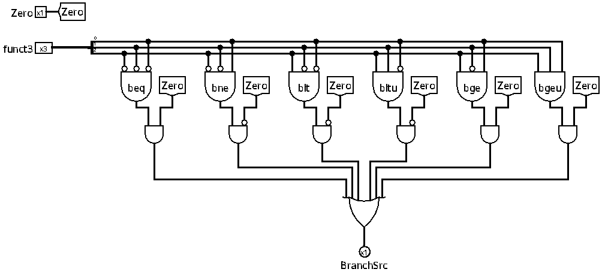

[Português](README.md) | [Español](README-es.md) | English

# Branch Control Unit

The branch control unit (`ucDesvio`) evaluates whether the conditions for conditional branches have been met. It examines the comparison flag generated by the ALU and the instruction's `funct3` field to determine whether program execution should take the branch.

 

## Interface

| Pin | Direction | Width | Description |
| :--- | :---: | :---: | :--- |
| `Zero` | Input | 1 bit | Equality/comparison flag from the ALU. |
| `funct3` | Input | 3 bits | Instruction field that identifies the branch comparison type. |
| `BranchSrc` | Output | 1 bit | Indicates whether the branch condition is met (`1`) or not (`0`). |

 

## Condition mapping table

The table below describes how `funct3` is decoded to check the corresponding condition using the `Zero` signal generated by the ALU:

| funct3 | Instruction | Comparison | Branch condition |
| :---: | :--- | :---: | :---: |
| `000` | `beq` (Branch Equal) | `A == B` (through subtraction) | `Zero == 1` |
| `001` | `bne` (Branch Not Equal) | `A != B` (through subtraction) | `Zero == 0` |
| `100` | `blt` (Branch Less Than) | `A < B` (signed) | `Zero == 0` |
| `101` | `bge` (Branch Greater or Equal) | `A >= B` (signed) | `Zero == 1` |
| `110` | `bltu` (Branch Less Than *Unsigned*) | `A < B` (unsigned) | `Zero == 0` |
| `111` | `bgeu` (Branch Greater or Equal *Unsigned*) | `A >= B` (unsigned) | `Zero == 1` |

 

## Operation

The branch unit does not perform mathematical calculations directly. It uses the results of operations that the ALU control unit has selected for the ALU to execute.

### Subtraction-based comparison (`beq` / `bne`)

To check equality or inequality, the ALU performs subtraction (`A - B`).

- **`beq`:** if `A - B == 0`, the ALU's `Zero` flag becomes `1`. The branch should be taken, so `BranchSrc = 1`.
- **`bne`:** if `A - B != 0`, the ALU's `Zero` flag remains `0`. The branch should be taken, so `BranchSrc = 1`.

### Less-than comparison (`blt` / `bge` / `bltu` / `bgeu`)

For branches based on less-than or greater-than-or-equal conditions, the ALU performs a *Set Less Than* comparison (`slt` or `sltu`).

- If `A < B` is **true**, the ALU produces the 32-bit result `1` (nonzero), making the `Zero` flag `0`.
- If `A < B` is **false** (which implies `A >= B`), the ALU produces `0`, setting the `Zero` flag to `1`.

Therefore:

- **`blt` / `bltu`:** branch if less than. Taken when the comparison is true, that is, `Zero == 0`.
- **`bge` / `bgeu`:** branch if greater than or equal. Taken when the comparison is false, that is, `Zero == 1`.

 

## Implementation

The unit uses purely combinational logic and consists of the following blocks:

- **Decoders / logic gates:** identify each of the 6 `funct3` patterns.
- **Condition validation gates:** combine the matching `funct3` pattern with `Zero` (directly or inverted through NOT gates).
- **Final OR gate:** combines the 6 comparison paths. If any decoded condition is met, the `BranchSrc` output is set to `1`.
