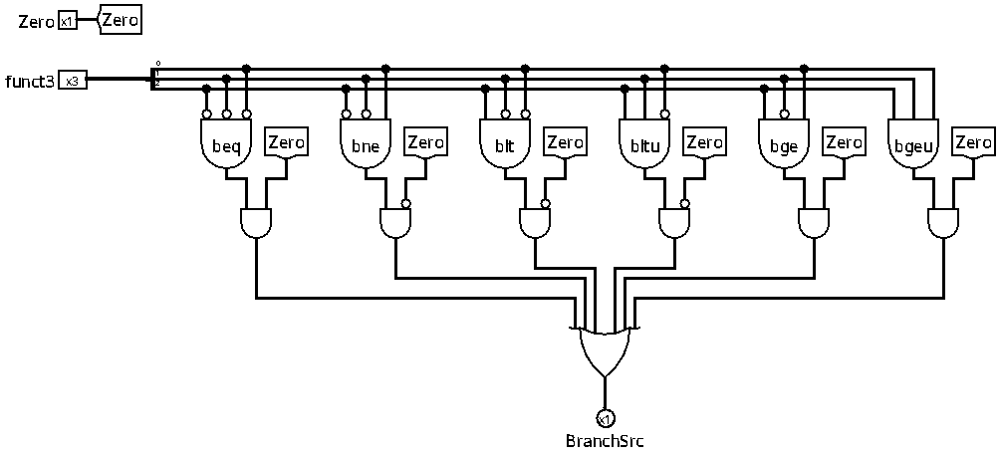

[Português](README.md) | Español | [English](README-en.md)

# Unidad de Control de Bifurcaciones

La unidad de control de bifurcaciones (`ucDesvio`) evalúa si se cumplen las condiciones de las bifurcaciones condicionales (*branches*). Analiza el indicador de comparación generado por la ALU y el campo `funct3` de la instrucción para determinar si el flujo del programa debe tomar la bifurcación.

 

## Interfaz

| Pin | Dirección | Ancho | Descripción |
| :--- | :---: | :---: | :--- |
| `Zero` | Entrada | 1 bit | Indicador de igualdad/comparación procedente de la ALU. |
| `funct3` | Entrada | 3 bits | Campo de la instrucción que identifica el tipo de comparación de la bifurcación. |
| `BranchSrc` | Salida | 1 bit | Indica si se cumple la condición de bifurcación (`1`) o no (`0`). |

 

## Tabla de correspondencia de condiciones

La siguiente tabla describe cómo se decodifica `funct3` para comprobar la condición correspondiente mediante la señal `Zero` generada por la ALU:

| funct3 | Instrucción | Comparación | Condición de bifurcación |
| :---: | :--- | :---: | :---: |
| `000` | `beq` (Branch Equal) | `A == B` (mediante resta) | `Zero == 1` |
| `001` | `bne` (Branch Not Equal) | `A != B` (mediante resta) | `Zero == 0` |
| `100` | `blt` (Branch Less Than) | `A < B` (con signo) | `Zero == 0` |
| `101` | `bge` (Branch Greater or Equal) | `A >= B` (con signo) | `Zero == 1` |
| `110` | `bltu` (Branch Less Than *Unsigned*) | `A < B` (sin signo) | `Zero == 0` |
| `111` | `bgeu` (Branch Greater or Equal *Unsigned*) | `A >= B` (sin signo) | `Zero == 1` |

 

## Funcionamiento

La unidad de bifurcaciones no realiza cálculos matemáticos directamente. Utiliza los resultados de las operaciones que la unidad de control de la ALU ha seleccionado para ejecutar en la ALU.

### Comparación mediante resta (`beq` / `bne`)

Para comprobar la igualdad o desigualdad, la ALU realiza una resta (`A - B`).

- **`beq`:** si `A - B == 0`, el indicador `Zero` de la ALU pasa a `1`. La bifurcación debe tomarse, por lo que `BranchSrc = 1`.
- **`bne`:** si `A - B != 0`, el indicador `Zero` de la ALU permanece en `0`. La bifurcación debe tomarse, por lo que `BranchSrc = 1`.

### Comparación menor que (`blt` / `bge` / `bltu` / `bgeu`)

Para las bifurcaciones basadas en condiciones de menor que o mayor o igual, la ALU ejecuta una comparación *Set Less Than* (`slt` o `sltu`).

- Si `A < B` es **verdadero**, la ALU produce el resultado de 32 bits `1` (distinto de cero), haciendo que el indicador `Zero` sea `0`.
- Si `A < B` es **falso** (lo que implica `A >= B`), la ALU produce `0`, activando el indicador `Zero` con el valor `1`.

Por tanto:

- **`blt` / `bltu`:** bifurcación si es menor. Se toma cuando la comparación es verdadera, es decir, `Zero == 0`.
- **`bge` / `bgeu`:** bifurcación si es mayor o igual. Se toma cuando la comparación es falsa, es decir, `Zero == 1`.

 

## Implementación

La unidad utiliza lógica puramente combinacional y consta de los siguientes bloques:

- **Decodificadores / puertas lógicas:** identifican cada uno de los 6 patrones de `funct3`.
- **Puertas de validación condicional:** combinan la identificación del patrón de `funct3` correspondiente con la señal `Zero` (directa o invertida mediante puertas NOT).
- **Puerta OR final:** combina los 6 caminos de comparación. Si se cumple cualquiera de las condiciones decodificadas, la salida `BranchSrc` se establece en `1`.
