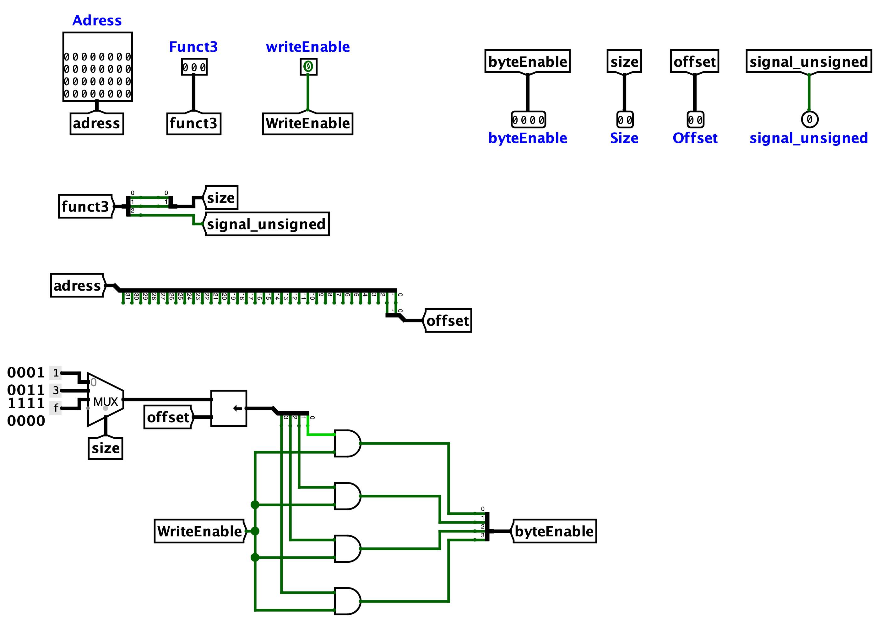

[Português](README.md) | Español (Coming soon) | English

# Addressing control unit

The Addressing Control Unit (`ucEnderecamento`) is the combinational component that prepares the access control signals for the **Data Memory**. From the instruction's `Funct3` field, the address calculated by the ALU (`Adress`), and the `writeEnable` signal, it determines the access size, data alignment, extension type, and which bytes must be written.

In other words, it translates *load* and *store* instructions (`lb`, `lh`, `lw`, `lbu`, `lhu`, `sb`, `sh`, `sw`) into the `Size`, `Offset`, `signal_unsigned`, and `byteEnable` signals required by the memory.

 

## Interface

| Pin | Direction | Width | Description |
| :--- | :---: | :---: | :--- |
| `Adress` | Input | 32 bits | Memory address calculated by the ALU. |
| `Funct3` | Input | 3 bits | Instruction field that defines the access type (size and sign). |
| `writeEnable` | Input | 1 bit | Indicates whether the operation is a write (`1` for *store*, `0` for *load*). |
| `Size` | Output | 2 bits | Access size: byte, half-word, or word. |
| `Offset` | Output | 2 bits | Data offset within the word (2 least significant bits of the address). |
| `signal_unsigned` | Output | 1 bit | Defines the read extension (`0` for sign, `1` for zero). |
| `byteEnable` | Output | 4 bits | Mask that indicates which of the four bytes of the word will be written. |

 

## Operation

The circuit derives all output signals combinationally, organized into three independent paths:

### 1. `Funct3` decoding
The `Funct3` field carries both the size and the signedness of the access at the same time. A splitter separates it into:
-   **`Size`** — the 2 least significant bits (`Funct3[1:0]`), which encode byte (`00`), half-word (`01`), or word (`10`).
-   **`signal_unsigned`** — the most significant bit (`Funct3[2]`), which differentiates signed from unsigned versions (for example, `lb` from `lbu` and `lh` from `lhu`).

 

### 2. `Offset` extraction
Since memory is byte-addressed but organized into 4-byte words, the 2 least significant bits of `Adress` indicate the byte position within the word. A splitter extracts `Adress[1:0]` and routes them directly to the `Offset` output.

 

### 3. `byteEnable` generation
The write mask is built in three stages:
-   **Base mask:** a multiplexer, controlled by `Size`, selects the byte pattern corresponding to the access size — `0001` (byte), `0011` (half-word), or `1111` (word).
-   **Alignment:** a shifter shifts this mask to the left according to the `Offset`, positioning the active bits over the correct bytes of the word.
-   **Enable:** finally, each bit of the mask passes through an `AND` gate with the `writeEnable` signal. Thus, `byteEnable` is only active during a write; during reads (`writeEnable = 0`), the resulting mask is `0000`, preventing any accidental writes.

> [!NOTE]
> The combination of base mask + shift by `Offset` is what allows an instruction such as `sb` to write only a specific byte of the word (for example, the third byte with `Offset = 10` results in `byteEnable = 0100`), without overwriting neighboring bytes.

 

## Implementation

The circuit is built from the following Logisim blocks:

- **Splitters:** separate `Funct3` into `Size` and `signal_unsigned` and extract the `Offset` from the least significant bits of `Adress`.
- **Multiplexer:** 2-bit `Size` selector that chooses the base byte mask from three constants (`0001` for byte, `0011` for half-word, and `1111` for word).
- **Shifter:** shifts the base mask to the left according to the `Offset`, aligning it to the correct position.
- **Logic gates (AND):** four gates that combine each bit of the shifted mask with `writeEnable`, producing the final `byteEnable` only during write operations.
- **Constants:** fixed byte mask values used as inputs to the multiplexer.