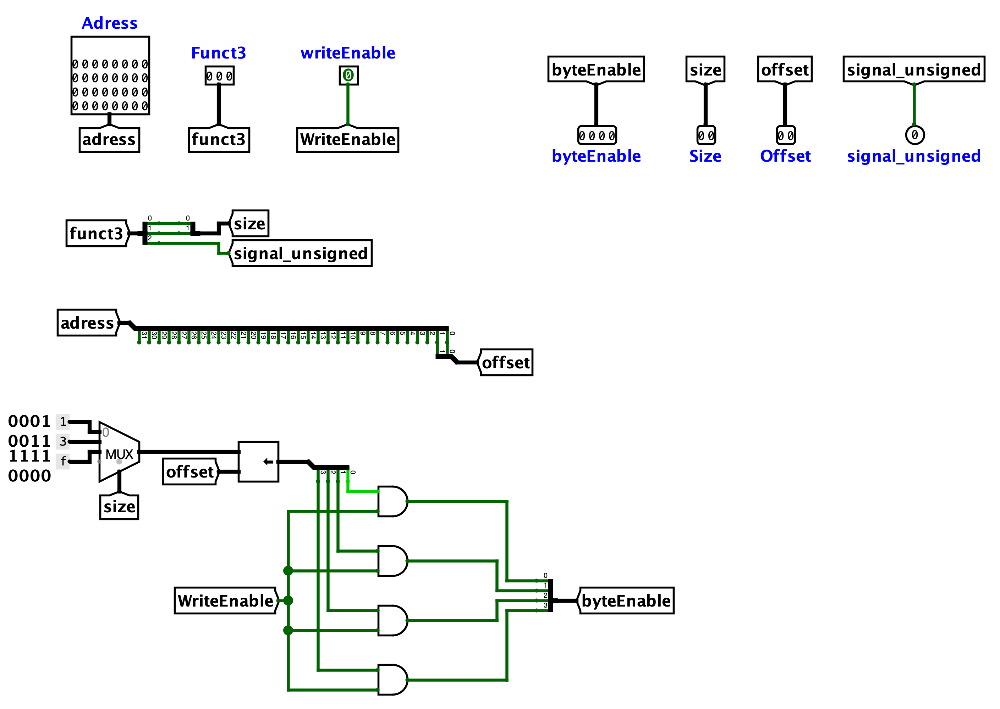

[Português](README.md) | Español | [English](README-en.md)

# Unidad de control de direccionamiento

La Unidad de Control de Direccionamiento es el componente combinacional que prepara las señales de control de acceso a la **Memoria de Datos**. A partir del campo `Funct3` de la instrucción, de la dirección calculada por la ALU (`Adress`) y de la señal `writeEnable`, determina el tamaño del acceso, la alineación del dato, el tipo de extensión y qué bytes deben escribirse.

En otras palabras, es quien traduce las instrucciones de *load* y *store* (`lb`, `lh`, `lw`, `lbu`, `lhu`, `sb`, `sh`, `sw`) en las señales `Size`, `Offset`, `signal_unsigned` y `byteEnable` que la memoria necesita.

 

## Interfaz

| Pin | Dirección | Ancho | Descripción |
| :--- | :---: | :---: | :--- |
| `Adress` | Entrada | 32 bits | Dirección de memoria calculada por la ALU. |
| `Funct3` | Entrada | 3 bits | Campo de la instrucción que define el tipo de acceso (tamaño y signo). |
| `writeEnable` | Entrada | 1 bit | Indica si la operación es una escritura (`1` para *store*, `0` para *load*). |
| `Size` | Salida | 2 bits | Tamaño del acceso: byte, media palabra o palabra. |
| `Offset` | Salida | 2 bits | Desplazamiento del dato dentro de la palabra (2 bits menos significativos de la dirección). |
| `signal_unsigned` | Salida | 1 bit | Define la extensión en la lectura (`0` para signo, `1` para cero). |
| `byteEnable` | Salida | 4 bits | Máscara que indica cuáles de los cuatro bytes de la palabra serán escritos. |

 

## Funcionamiento

El circuito deriva todas las señales de salida de forma combinacional, organizadas en tres caminos independientes:

### 1. Decodificación de `Funct3`
El campo `Funct3` lleva, al mismo tiempo, el tamaño y el signo del acceso. Un distribuidor lo separa en:
-   **`Size`** — los 2 bits menos significativos (`Funct3[1:0]`), que codifican byte (`00`), media palabra (`01`) o palabra (`10`).
-   **`signal_unsigned`** — el bit más significativo (`Funct3[2]`), que diferencia las versiones con signo de las sin signo (por ejemplo, `lb` de `lbu` y `lh` de `lhu`).

 

### 2. Extracción de `Offset`
Como la memoria está direccionada por byte pero organizada en palabras de 4 bytes, los 2 bits menos significativos de `Adress` indican la posición del byte dentro de la palabra. Un distribuidor extrae `Adress[1:0]` y los encamina directamente hacia la salida `Offset`.

 

### 3. Generación de `byteEnable`
La máscara de escritura se construye en tres etapas:
-   **Máscara base:** un multiplexor, controlado por `Size`, selecciona el patrón de bytes correspondiente al tamaño del acceso — `0001` (byte), `0011` (media palabra) o `1111` (palabra).
-   **Alineación:** un desplazador (*shifter*) desplaza esa máscara hacia la izquierda de acuerdo con el `Offset`, posicionando los bits activos sobre los bytes correctos de la palabra.
-   **Habilitación:** finalmente, cada bit de la máscara pasa por una compuerta `AND` con la señal `writeEnable`. Así, `byteEnable` solo queda activo durante una escritura; en lecturas (`writeEnable = 0`), la máscara resultante es `0000`, evitando cualquier grabación accidental.

> [!NOTE]
> La combinación de máscara base + desplazamiento por `Offset` es lo que permite que una instrucción como `sb` grabe únicamente un byte específico de la palabra (por ejemplo, el tercer byte con `Offset = 10` resulta en `byteEnable = 0100`), sin sobrescribir los bytes vecinos.

 

## Implementación

El circuito está construido a partir de los siguientes bloques de Logisim:

- **Distribuidores (*splitters*):** separan `Funct3` en `Size` y `signal_unsigned` y extraen el `Offset` de los bits menos significativos de `Adress`.
- **Multiplexor:** selector de `Size` (2 bits) que elige la máscara base de bytes a partir de tres constantes (`0001` para byte, `0011` para media palabra y `1111` para palabra).
- **Desplazador (*shifter*):** desplaza la máscara base hacia la izquierda según el `Offset`, alineándola a la posición correcta.
- **Compuertas lógicas (AND):** cuatro compuertas que combinan cada bit de la máscara desplazada con `writeEnable`, produciendo el `byteEnable` final únicamente en operaciones de escritura.
- **Constantes:** valores fijos de las máscaras de byte usados como entradas del multiplexor.