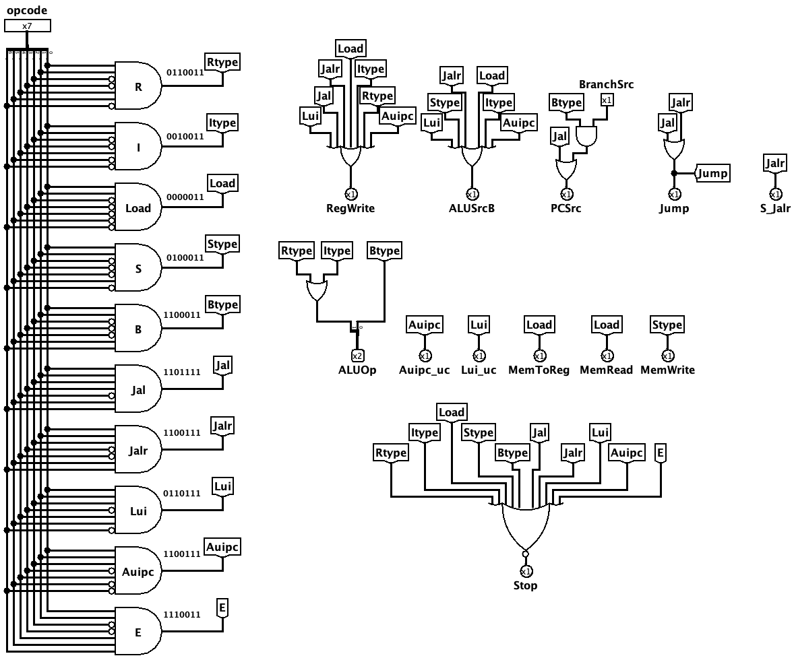

[Português](README.md) | [Español](README-es.md) | English

# Main Control Unit

The main control unit is the processor's "brain": it uses the instruction's 7-bit `opcode` field to identify the instruction type and assert the **control signals** that coordinate all other datapath components (register file, ALU, data memory, multiplexers and branch logic). It also receives `BranchSrc` (the externally evaluated branch condition) to decide whether a branch should be taken.

Because it is purely combinational, it does not depend on the clock: as soon as `opcode` settles, all control signals for that instruction are generated simultaneously.

 

## Interface

| Pin | Direction | Width | Description |
| :--- | :---: | :---: | :--- |
| `opcode` | Input | 7 bits | Instruction field `[6:0]`, which identifies its format and category. |
| `BranchSrc` | Input | 1 bit | Branch condition (from the branch unit): indicates whether the branch should be taken. |
| `RegWrite` | Output | 1 bit | Enables writing to the register file. |
| `ALUSrcB` | Output | 1 bit | Selects the ALU's second operand (`0` = register `rs2`, `1` = immediate). |
| `ALUOp` | Output | 2 bits | Operation category sent to `ucULA` (`00` memory, `01` branch, `10` arithmetic/logic). |
| `MemRead` | Output | 1 bit | Enables reading from data memory. |
| `MemWrite` | Output | 1 bit | Enables writing to data memory. |
| `MemToReg` | Output | 1 bit | Selects the source of the data written to the register (`0` = ALU, `1` = memory). |
| `PCSrc` | Output | 1 bit | Selects the source of the next PC (active for a taken branch or a jump). |
| `Jump` | Output | 1 bit | Indicates an unconditional jump (`jal`/`jalr`). |
| `S_Jalr` | Output | 1 bit | Selects the behavior specific to `jalr`. |
| `Auipc_uc` | Output | 1 bit | Control specific to the `auipc` instruction. |
| `Lui_uc` | Output | 1 bit | Control specific to the `lui` instruction. |
| `Stop` | Output | 1 bit | Signals that the processor should stop (invalid opcode / end of program). |

 

## `opcode` decoding table

Each instruction category is recognized by a unique `opcode` pattern:

| Internal signal | Opcode | Category / Examples |
| :--- | :---: | :--- |
| `Rtype` | `0110011` | Register-register arithmetic/logic (`add`, `sub`, `and`, `or`…). |
| `Itype` | `0010011` | Arithmetic/logic with an immediate (`addi`, `ori`, `slli`…). |
| `Load` | `0000011` | Memory reads (`lw`, `lh`, `lb`, `lhu`, `lbu`). |
| `Stype` | `0100011` | Memory writes (`sw`, `sh`, `sb`). |
| `Btype` | `1100011` | Conditional branches (`beq`, `bne`, `blt`…). |
| `Jal` | `1101111` | Relative unconditional jump (`jal`). |
| `Jalr` | `1100111` | Indirect unconditional jump (`jalr`). |
| `Lui` | `0110111` | Load upper immediate (`lui`). |
| `Auipc` | `0010111` | Add upper immediate to PC (`auipc`). |
| `E` | `1110011` | System instructions (`ecall`/`ebreak`). |

 

## Operation

The circuit operates in two combinational stages:

### 1. `opcode` decoding

The 7-bit `opcode` is distributed to a set of `AND` gates (with inverters at the appropriate positions), one for each category in the table above. The gate matching the received pattern produces `1`, generating an internal signal (`Rtype`, `Itype`, `Load`, etc.) that identifies the current instruction.

 

### 2. Control signal generation

Each output signal is formed by an `OR` gate that combines the instruction types that need to assert it. The main groups are:

- **`RegWrite`** — active for all instructions that write to a register: `Rtype`, `Itype`, `Load`, `Jal`, `Jalr`, `Lui` and `Auipc`.
- **`ALUSrcB`** — active when the second operand comes from an immediate: `Itype`, `Load`, `Stype`, `Jalr`, `Lui` and `Auipc`.
- **`ALUOp`** — consists of two bits: `Rtype`/`Itype` select `10` (arithmetic/logic) and `Btype` selects `01` (branch); for `Load`/`Stype` it remains `00` (address addition).
- **`MemRead`** and **`MemToReg`** — active only for `Load`.
- **`MemWrite`** — active only for `Stype`.
- **`PCSrc`** — active when the next PC is not sequential: either for a **jump** (`Jal`/`Jalr`) or a **taken branch**. For a branch, an `AND` gate combines `Btype` with input `BranchSrc`, so the branch changes the PC only when the externally evaluated condition is true.
- **`Jump`** = `Jal` OR `Jalr`; **`S_Jalr`** = `Jalr`.
- **`Auipc_uc`** and **`Lui_uc`** — active exclusively for `Auipc` and `Lui`, respectively.

> [!NOTE]
> **`Stop`** is generated by a 10-input `NOR` gate — one input for each recognized instruction category. Its output becomes `1` only when **none** of the categories matches, meaning that `opcode` is invalid (for example, when fetching a zeroed memory location after the end of the program), signaling that the processor should stop.

 

## Implementation

The circuit is built from the following Logisim blocks:

- **Splitters:** split the 7-bit `opcode` to feed the decoding logic and recombine the `ALUOp` bits.
- **AND gates (decoders):** one per category, with inputs inverted according to the pattern, generating the internal signals for each instruction type.
- **OR gates:** combine category signals to produce each output control signal (`RegWrite`, `ALUSrcB`, `Jump`, `PCSrc`, etc.).
- **AND gate (taken branch):** combines `Btype` with input `BranchSrc` to condition `PCSrc`.
- **NOR gate:** combines the 10 categories to generate `Stop` when no valid instruction is present.
