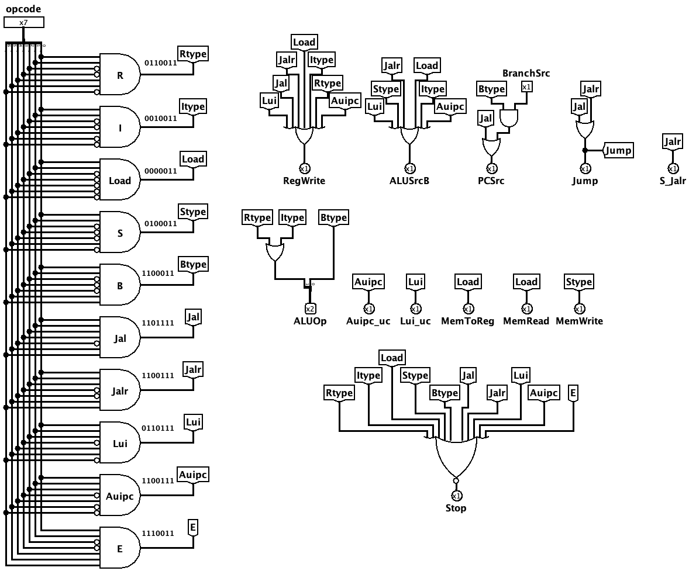

[Português](README.md) | Español | [English](README-en.md)

# Unidad de Control Principal

La unidad de control principal es el "cerebro" del procesador: a partir del campo `opcode` (7 bits) de la instrucción, identifica el tipo de instrucción y activa las **señales de control** que coordinan los demás componentes del datapath (banco de registros, ALU, memoria de datos, multiplexores y lógica de bifurcaciones). También recibe la señal `BranchSrc` (condición de bifurcación evaluada externamente) para decidir si debe tomarse una bifurcación.

Como es puramente combinacional, no depende del reloj: en cuanto se estabiliza `opcode`, se generan simultáneamente todas las señales de control de esa instrucción.

 

## Interfaz

| Pin | Dirección | Ancho | Descripción |
| :--- | :---: | :---: | :--- |
| `opcode` | Entrada | 7 bits | Campo `[6:0]` de la instrucción, que identifica su formato y categoría. |
| `BranchSrc` | Entrada | 1 bit | Condición de bifurcación (procedente de la unidad de bifurcaciones): indica si debe tomarse la bifurcación. |
| `RegWrite` | Salida | 1 bit | Habilita la escritura en el banco de registros. |
| `ALUSrcB` | Salida | 1 bit | Selecciona el segundo operando de la ALU (`0` = registro `rs2`, `1` = inmediato). |
| `ALUOp` | Salida | 2 bits | Categoría de operación enviada a `ucULA` (`00` memoria, `01` bifurcación, `10` aritmética/lógica). |
| `MemRead` | Salida | 1 bit | Habilita la lectura de la memoria de datos. |
| `MemWrite` | Salida | 1 bit | Habilita la escritura en la memoria de datos. |
| `MemToReg` | Salida | 1 bit | Selecciona el origen del dato escrito en el registro (`0` = ALU, `1` = memoria). |
| `PCSrc` | Salida | 1 bit | Selecciona el origen del próximo PC (activo en una bifurcación tomada o un salto). |
| `Jump` | Salida | 1 bit | Indica un salto incondicional (`jal`/`jalr`). |
| `S_Jalr` | Salida | 1 bit | Selecciona el comportamiento específico de `jalr`. |
| `Auipc_uc` | Salida | 1 bit | Control específico de la instrucción `auipc`. |
| `Lui_uc` | Salida | 1 bit | Control específico de la instrucción `lui`. |
| `Stop` | Salida | 1 bit | Indica la parada del procesador (opcode inválido / fin del programa). |

 

## Tabla de decodificación de `opcode`

Cada categoría de instrucción se reconoce mediante un patrón único de `opcode`:

| Señal interna | Opcode | Categoría / Ejemplos |
| :--- | :---: | :--- |
| `Rtype` | `0110011` | Operaciones aritméticas/lógicas entre registros (`add`, `sub`, `and`, `or`…). |
| `Itype` | `0010011` | Operaciones aritméticas/lógicas con inmediato (`addi`, `ori`, `slli`…). |
| `Load` | `0000011` | Lectura de memoria (`lw`, `lh`, `lb`, `lhu`, `lbu`). |
| `Stype` | `0100011` | Escritura en memoria (`sw`, `sh`, `sb`). |
| `Btype` | `1100011` | Bifurcaciones condicionales (`beq`, `bne`, `blt`…). |
| `Jal` | `1101111` | Salto incondicional relativo (`jal`). |
| `Jalr` | `1100111` | Salto incondicional indirecto (`jalr`). |
| `Lui` | `0110111` | Carga de inmediato superior (`lui`). |
| `Auipc` | `0010111` | Suma de inmediato superior al PC (`auipc`). |
| `E` | `1110011` | Instrucciones de sistema (`ecall`/`ebreak`). |

 

## Funcionamiento

El circuito funciona en dos etapas combinacionales:

### 1. Decodificación de `opcode`

El `opcode` de 7 bits se distribuye a un conjunto de puertas `AND` (con inversores en las posiciones adecuadas), una por cada categoría de la tabla anterior. La puerta que coincide con el patrón recibido produce `1`, generando una señal interna (`Rtype`, `Itype`, `Load`, etc.) que identifica la instrucción actual.

 

### 2. Generación de las señales de control

Cada señal de salida se forma mediante una puerta `OR` que combina los tipos de instrucción que necesitan activarla. Las principales agrupaciones son:

- **`RegWrite`** — activo para todas las instrucciones que escriben en un registro: `Rtype`, `Itype`, `Load`, `Jal`, `Jalr`, `Lui` y `Auipc`.
- **`ALUSrcB`** — activo cuando el segundo operando procede de un inmediato: `Itype`, `Load`, `Stype`, `Jalr`, `Lui` y `Auipc`.
- **`ALUOp`** — consta de dos bits: `Rtype`/`Itype` seleccionan `10` (aritmética/lógica) y `Btype` selecciona `01` (bifurcación); para `Load`/`Stype` permanece en `00` (suma de dirección).
- **`MemRead`** y **`MemToReg`** — activos solo para `Load`.
- **`MemWrite`** — activo solo para `Stype`.
- **`PCSrc`** — activo cuando el próximo PC no es secuencial: en un **salto** (`Jal`/`Jalr`) o en una **bifurcación tomada**. Para la bifurcación, una puerta `AND` combina `Btype` con la entrada `BranchSrc`, de modo que la bifurcación solo modifica el PC cuando la condición evaluada externamente es verdadera.
- **`Jump`** = `Jal` O `Jalr`; **`S_Jalr`** = `Jalr`.
- **`Auipc_uc`** y **`Lui_uc`** — activos exclusivamente para `Auipc` y `Lui`, respectivamente.

> [!NOTE]
> La señal **`Stop`** se genera mediante una puerta `NOR` de 10 entradas — una por cada categoría de instrucción reconocida. Su salida solo pasa a `1` cuando **ninguna** categoría coincide, es decir, cuando `opcode` es inválido (por ejemplo, al buscar una posición de memoria con valor cero después del fin del programa), indicando que el procesador debe detenerse.

 

## Implementación

El circuito se construye con los siguientes bloques de Logisim:

- **Divisores (*splitters*):** separan los bits del `opcode` de 7 bits para alimentar la lógica de decodificación y recombinan los bits de `ALUOp`.
- **Puertas AND (decodificadores):** una por categoría, con entradas negadas según el patrón, que generan las señales internas de cada tipo de instrucción.
- **Puertas OR:** combinan las señales de categoría para producir cada señal de control de salida (`RegWrite`, `ALUSrcB`, `Jump`, `PCSrc`, etc.).
- **Puerta AND (bifurcación tomada):** combina `Btype` con la entrada `BranchSrc` para condicionar `PCSrc`.
- **Puerta NOR:** combina las 10 categorías para generar `Stop` cuando no hay una instrucción válida.
