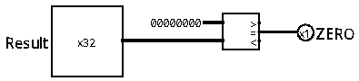

[Português](README.md) | [Español](README-es.md) | English

# Zero Detector

The zero detector is an internal component of the arithmetic and logic unit (ALU). It checks whether the 32-bit result of an arithmetic or logic operation is zero, producing a 1-bit boolean signal (`Zero`) that is essential for conditional branch decisions.

 

## Interface

| Pin | Direction | Width | Description |
| :--- | :---: | :---: | :--- |
| `Result` | Input | 32 bits | Final result of the operation performed by the ALU. |
| `Zero` | Output | 1 bit | Zero-result flag (`1` if the result is zero, `0` otherwise). |

 

## Operation

The circuit performs a simple equality test using purely combinational logic:

- **Result equals zero (`Result == 0`):** when all 32 bits of `Result` are at logic level low (`0`), the equality condition is met and output `Zero` is asserted (`Zero = 1`).
- **Result differs from zero (`Result != 0`):** if at least one of the 32 input bits is at logic level high (`1`), the equality comparison fails and the output is deasserted (`Zero = 0`).

 

## Implementation

The circuit uses a simple combinational block for a fast comparison:

- **Comparator:** configured to compare the 32-bit input `Result` with a constant value of `0` (`0x00000000`). It checks whether the two inputs are equal (`=`) and sends the corresponding boolean result directly to output `Zero`.
