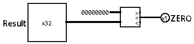

[Português](README.md) | Español | [English](README-en.md)

# Detector de Cero

El detector de cero es un componente interno de la unidad aritmética y lógica (ALU). Comprueba si el resultado de 32 bits de una operación aritmética o lógica es igual a cero y genera una señal booleana (`Zero`) de 1 bit, fundamental para decidir las bifurcaciones condicionales (*branches*).

 

## Interfaz

| Pin | Dirección | Ancho | Descripción |
| :--- | :---: | :---: | :--- |
| `Result` | Entrada | 32 bits | Resultado final de la operación realizada por la ALU. |
| `Zero` | Salida | 1 bit | Indicador de resultado cero (`1` si el resultado es cero, `0` en caso contrario). |

 

## Funcionamiento

El circuito realiza una prueba sencilla de igualdad mediante lógica puramente combinacional:

- **Resultado igual a cero (`Result == 0`):** cuando los 32 bits de `Result` están en nivel lógico bajo (`0`), se cumple la condición de igualdad y se activa la salida `Zero` (`Zero = 1`).
- **Resultado distinto de cero (`Result != 0`):** si al menos uno de los 32 bits de entrada está en nivel lógico alto (`1`), la comparación de igualdad falla y se desactiva la salida (`Zero = 0`).

 

## Implementación

El circuito utiliza un bloque combinacional sencillo para realizar una comparación rápida:

- **Comparador:** configurado para comparar la entrada de 32 bits `Result` con una constante de valor `0` (`0x00000000`). Evalúa si las dos entradas son iguales (`=`) y envía el resultado booleano correspondiente directamente a la salida `Zero`.
