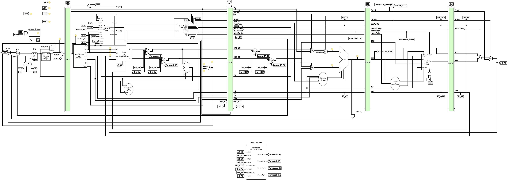

[Português](README.md) | [Español](README-es.md) | English

# Datapath - Pipeline with forwarding and automatic bubbles



RISC-V processor implementation with a **5-stage pipeline** that resolves data hazards in hardware in both ways described by Patterson and Hennessy (section 4.7, _Data Hazards: Forwarding versus Stalling_):

- **Forwarding**: the value an instruction needs is taken from the stage where it has already been computed, without waiting for the register file write.
- **Automatic bubbles**: when the value has not been computed anywhere yet, the circuit stalls fetch and decode and inserts a bubble.

Bubbles only appear when forwarding cannot resolve the hazard: a _load_ followed by an instruction that uses its result, and a conditional branch that depends on the instruction right before it. This is the final pipeline of chapter 4 of the book (figure 4.62), extended to the RV32I instructions implemented in the project (arithmetic and logic, _loads_ and _stores_ of every size, the six branches, `jal`, `jalr`, `lui` and `auipc`).

The base is the [pipeline with bubbles](../pipeline_bubble/README-en.md): stages, control unit, branch and jump handling, the `Stop` signal and clock edges are the same. Forwarding comes from the [pipeline with forwarding](../pipelineEncaminhamento/README.md). This manual describes how both parts were combined.

<br>

## What changes from the pipeline with bubbles

| Change | Stage | Function |
| :--- | :---: | :--- |
| [`ucEncaminhamento`](../../componentes/pipelineComponentes/ucEncaminhamento/) | ID and EX | Generates `ForwardA_ID`, `ForwardB_ID`, `ForwardA_EX` and `ForwardB_EX` by comparing `rs1`/`rs2` of ID and EX with the `rd` of the instructions in MEM and WB. |
| `ForwardA_ID` and `ForwardB_ID` MUXes | ID | At the register file output: select the `idULA` operands (branches) and what goes into `ID/EX`. |
| `ForwardA_EX` and `ForwardB_EX` MUXes | EX | At the `ID/EX` output: select the ALU operands and the _store_ data. |
| `wd_MEM` MUX | MEM | Builds the value the instruction in MEM will write: ALU result or `PC + 4` (`jal`/`jalr`). |
| [`ucConflitos`](../../componentes/pipelineComponentes/ucConflitos/) instead of `hazard_detection_unit` | ID | Same place, same block and same connections; stalls only in the cases forwarding does not cover. The branch logic is the same. |
| [`estagioID_EX_bolha`](../../componentes/estagiosPipeline/estagioID_EX_bolha/) instead of `ID_EX_stage_bubble` | ID &rarr; EX | Same bubble (`Clear`), plus `rs1_EX` and `rs2_EX` for forwarding in EX. |

`ucConflitos` takes exactly the place of `hazard_detection_unit`, with the same block and the same wires and tunnels. The only changes around it are the ones needed for the new ports:

- the `RW_MEM` tunnel that reached the unit became `MemRead_MEM`;
- the block grew 40 px taller to receive `MemRead_EX` (tunnel) and `opcode_ID` (a direct wire from `opcode`, which runs right below it). Since it now covers the row the `PCSrc` wire used, `PCSrc_ID` goes from the control unit to the hazard unit by tunnel;
- the probe showing the instruction in ID moved 30 px left to make room for the `MemRead_EX` tunnel;
- the wires that already carried `rs1` and `rs2` to the unit got the `rs1_ID` and `rs2_ID` tunnels, used by `ID/EX` and `ucEncaminhamento`.

`ucEncaminhamento` sits at the bottom of the circuit, connected only by tunnels, as in `pipelineEncaminhamento`.

<br>

## Forwarding

Forwarding is the same as in the [pipeline with forwarding](../pipelineEncaminhamento/README.md#valores-encaminhados). The four MUXes use the book's encoding:

| Selector | MUX input | Tunnel | Value |
| :---: | :---: | :--- | :--- |
| `00` | 0 | — | Value read from the register file (ID) or held in `ID/EX` (EX). |
| `01` | 1 | `wd_WB` | Value being written by WB (output of the `Jump` MUX). |
| `10` | 2 | `wd_MEM` | Value the instruction in MEM will write (output of the `wd_MEM` MUX). |
| `11` | 3 | — | Never generated; the input is left unconnected. |

```
EX:  ld1_EX ─► MUX ForwardA_EX ─► MUX Auipc ─► MUX Lui ─► ALU (A)
     ld2_EX ─► MUX ForwardB_EX ─┬─► MUX ALUSrcB ────────► ALU (B)
                                └─► EX/MEM (store data)

ID:  ld1 (reg. file) ─► MUX ForwardA_ID ─┬─► idULA (A)
                                         └─► ID/EX
     ld2 (reg. file) ─► MUX ForwardB_ID ─┬─► idULA (B)
                                         └─► ID/EX
```

- In EX this is the book's classic forwarding (figures 4.52 and 4.55). Since `ForwardA_EX` comes before `Auipc`/`Lui` and `ForwardB_EX` before `ALUSrcB`, the `PC`, the `0` and the immediate still reach the ALU for those instructions. The `jalr` base is forwarded too, since its target comes out of the ALU.
- In ID, the MUXes feed the `idULA`, which decides branches. The book points out that moving the branch decision to ID requires this new forwarding logic, with values from `EX/MEM` and `MEM/WB` (section 4.8).
- The `wd_MEM` MUX exists because `jal` and `jalr` write `PC + 4`, not the ALU result. It repeats in MEM the choice the `Jump` MUX makes in WB.

### The WB &rarr; ID path
The register file writes on the **rising** clock edge and the stage registers on the **falling** edge ([clock edges](../pipeline/README.md#bordas-de-clock)). When one instruction is in WB and another in ID, the register file already returns the new value before `ID/EX` captures it, so input `01` (`wd_WB`) of the ID MUXes delivers the same value as the register file. This path is **redundant**, but it was kept:

- `ucEncaminhamento` applies the same rule to both stages and is the same component used in `pipelineEncaminhamento`; removing the path would require a different unit just for ID;
- it costs no cycle and changes no result;
- it matches what the book describes for ID, where branch operands can come from `EX/MEM` **or** `MEM/WB`.

<br>

## Hazard detection

[`ucConflitos`](../../componentes/pipelineComponentes/ucConflitos/) stalls the pipeline (`Stall = 1`) only when the value does not exist yet:

| Case | Condition | Bubbles |
| :--- | :--- | :---: |
| _Load_ followed by use | `MemRead_EX` and `rd_EX ≠ 0` and `rd_EX` is read by the instruction in ID | 1 |
| Write followed by branch | conditional branch in ID and `RegWrite_EX` and `rd_EX ≠ 0` and `rd_EX` is read by the branch | 1 |
| _Load_ followed by branch (2nd bubble) | conditional branch in ID and `MemRead_MEM` and `rd_MEM ≠ 0` and `rd_MEM` is read by the branch | +1 |

The first is the book's condition in section 4.7; the other two come from section 4.8, which decides branches in ID. `jalr` reads its base in EX, so only the _load_ rule applies to it. As in `pipeline_bubble`, the `read_rs1` and `read_rs2` signals avoid false dependences on fields that are part of the immediate in some instructions.

During a stall, as in the book:

1. `PC` and `IF/ID` keep their values (enable `NOT Stall OR Jalr_EX`).
2. `Bubble_ID` writes a bubble into `ID/EX`, with every control signal at `0`.
3. EX, MEM and WB keep advancing until the value can be forwarded.

<br>

## Branches and jumps

The same as in the [pipeline with bubbles](../pipeline_bubble/README-en.md):

```text
Redirect_ID = PCSrc_ID AND NOT Stall AND NOT Jalr_EX
Flush_IF    = Redirect_ID OR Jalr_EX
Bubble_ID   = Stall OR Jalr_EX
```

| Situation | Behavior |
| :--- | :--- |
| Branch not taken | Continues at `PC + 4`, nothing discarded. |
| Branch taken or `jal` in ID | Redirects to `PC_ID + imm_ID` and discards the fetched instruction: **1 bubble**. |
| Branch with a pending operand | Waits in ID (see [Hazard detection](#hazard-detection)). |
| `jalr` in EX | Redirects to the ALU target and discards IF and ID: **2 bubbles**. |

<br>

## Bubbles measured in the circuit

Each case was measured by running the program with and without the dependence and counting the difference in cycles.

| Writer &rarr; reader | Pipeline with bubbles | **This datapath** |
| :--- | :---: | :---: |
| ALU &rarr; ALU | 2 | **0** |
| ALU &rarr; ALU, 1 instruction between them | 1 | **0** |
| ALU &rarr; `sw` (data or base) | 2 | **0** |
| ALU &rarr; `jalr` base | 2 | **0** |
| `jal` &rarr; use of the return address | 1 | **0** |
| _Load_ &rarr; use in EX (ALU, `sw`, `jalr` base) | 2 | **1** |
| _Load_ &rarr; use, 1 instruction between them | 1 | **0** |
| ALU &rarr; conditional branch | 2 | **1** |
| ALU &rarr; branch, 1 instruction between them | 1 | **0** |
| _Load_ &rarr; conditional branch | 2 | **2** |
| _Load_ &rarr; branch, 1 instruction between them | 1 | **1** |
| Branch taken or `jal` | 1 | **1** |
| `jalr` | 2 | **2** |
| Branch not taken | 0 | **0** |

> [!NOTE]
> A _store_ right after a _load_ that stores the loaded value (`lw x1` followed by `sw x1`) also waits 1 cycle, as in the book: the _store_ data is treated like any other use in EX.

<br>

## New signals

| Tunnel | Width | Source | Destination |
| :--- | :---: | :--- | :--- |
| `rs1_ID`, `rs2_ID` | 5 bits | Wires carrying `rs1`/`rs2` from the decoder to `ucConflitos` | `ID/EX` and `ucEncaminhamento` |
| `rs1_EX`, `rs2_EX` | 5 bits | `ID/EX` | `ucEncaminhamento` |
| `MemRead_EX` | 1 bit | `ID/EX` | `ucConflitos` |
| `MemRead_MEM` | 1 bit | `EX/MEM` | `ucConflitos` (instead of `RW_MEM`, no longer used by the unit) |
| `PCSrc_ID` | 1 bit | `control_unit_bubble` | `ucConflitos` (previously a wire) |
| `ALUResult_MEM` | 32 bits | `EX/MEM` | `wd_MEM` MUX |
| `wd_MEM`, `wd_WB` | 32 bits | `wd_MEM` MUX and `Jump` MUX | Inputs 2 and 1 of the four forwarding MUXes |
| `ForwardA_ID`, `ForwardB_ID`, `ForwardA_EX`, `ForwardB_EX` | 2 bits | `ucEncaminhamento` | Forwarding MUXes |

`ucEncaminhamento` also uses tunnels that already existed in `pipeline_bubble`: `rd_MEM`, `RW_MEM`, `rd_WB` and `RW_WB`.

<br>

## Tests

- **Units:** `ucConflitos` passed 26,736 test vectors and `ucEncaminhamento` 6,916 (every combination with registers `x0` to `x2` plus random combinations over all 32 registers).
- **Programs in [`codigos/`](../../codigos/):** the sequence of register file and memory writes is identical to an ISA emulator and to `pipeline_bubble`, in fewer cycles when there are dependences:

| Program | Pipeline with bubbles | **This datapath** |
| :--- | :---: | :---: |
| `fatorial` (no `nop`) | 126 | **121** |
| `soma_vetor` (no `nop`) | 73 | **52** |
| `teste_encaminhamento` | 242 | **136** |
| `teste_encaminhamento` (no `nop`) | 238 | **132** |
| `teste_geral` (no `nop`) | 521 | **265** |
| `_pipeline` versions (with the simple pipeline's `nop`s) | same | same |

- **Random programs:** 60 programs of about 170 instructions, without any `nop`, using every implemented instruction and many back-to-back dependences (including dependent _loads_ and branches, `jal`, `jalr` and a loop): all identical to the emulator.

<br>

## What comes from the book and what does not

| From the book (Patterson and Hennessy, ch. 4) | Specific to this project |
| :--- | :--- |
| Forwarding unit with the `EX/MEM` and `MEM/WB` conditions, `rd ≠ 0`, `RegWrite` and `EX/MEM` priority (section 4.7). | `rs1`/`rs2` actually read (`read_rs1`/`read_rs2`), to avoid false stalls on immediate fields; conditional branch recognized from the `opcode` inside the unit. |
| Hazard detection unit with the _load_ condition, the bubble made by zeroing the `ID/EX` controls and freezing `PC` and `IF/ID` (section 4.7, figures 4.57 and 4.58). | Forwarding of `PC + 4` (`wd_MEM` MUX) for `jal`/`jalr`, which the book does not cover. |
| Branch decided in ID, with forwarding to the comparison and stalls of 1 cycle after an ALU instruction and 2 after a _load_ (section 4.8). | `jalr` resolved in EX, discarding IF and ID (2 bubbles) and taking priority over the stall. |
| `IF.Flush` turning the fetched instruction into a `nop` on a taken branch (section 4.8). | Every RV32I branch (`beq` to `bgeu`) compared in the `idULA`, not just equality. |
| Register file written in the first half of the cycle and read in the second (section 4.7). | Inverted edges in Logisim (stages on the falling edge, register file and memory on the rising edge) and the WB &rarr; ID path kept for uniformity. |
| | `Stop` signal to halt the simulation. |

<br>

## File

- **`main.circ`** — complete datapath circuit (open in Logisim-Evolution).
