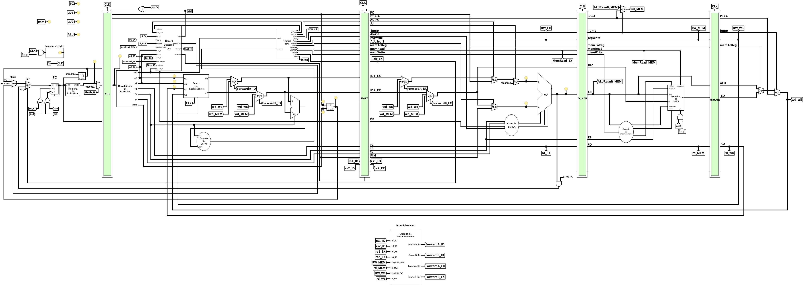

[Português](README.md) | Español | [English](README-en.md)

# Datapath - Pipeline con reenvío y burbujas automáticas



Implementación del procesador RISC-V con **pipeline de 5 etapas** que resuelve los conflictos de datos en hardware de las dos formas descritas por Patterson y Hennessy (sección 4.7, _Data Hazards: Forwarding versus Stalling_):

- **Reenvío** (_forwarding_): el valor que necesita una instrucción se toma de la etapa en la que ya fue calculado, sin esperar la escritura en el banco.
- **Burbujas automáticas**: cuando el valor todavía no fue calculado en ninguna parte, el circuito detiene la búsqueda y la decodificación e inserta una burbuja.

Las burbujas solo aparecen cuando el reenvío no resuelve el conflicto: un _load_ seguido de una instrucción que usa el resultado y una bifurcación condicional que depende de la instrucción inmediatamente anterior. Es el _pipeline_ final del capítulo 4 del libro (figura 4.62), extendido a las instrucciones de la RV32I implementadas en el proyecto (aritméticas y lógicas, _loads_ y _stores_ de todos los tamaños, las seis bifurcaciones, `jal`, `jalr`, `lui` y `auipc`).

La base es el [pipeline con burbujas](../pipeline_bubble/README-es.md): etapas, unidad de control, tratamiento de bifurcaciones y saltos, señal `Stop` y flancos de reloj son los mismos. El reenvío es el del [pipeline con reenvío](../pipelineEncaminhamento/README.md). Este manual describe cómo se unieron ambas partes.

<br>

## Qué cambia respecto al pipeline con burbujas

| Cambio | Etapa | Función |
| :--- | :---: | :--- |
| [`ucEncaminhamento`](../../componentes/pipelineComponentes/ucEncaminhamento/) | ID y EX | Genera `ForwardA_ID`, `ForwardB_ID`, `ForwardA_EX` y `ForwardB_EX` comparando `rs1`/`rs2` de ID y EX con el `rd` de las instrucciones en MEM y WB. |
| MUX `ForwardA_ID` y `ForwardB_ID` | ID | A la salida del banco: eligen los operandos de la `idULA` (bifurcaciones) y lo que va al `ID/EX`. |
| MUX `ForwardA_EX` y `ForwardB_EX` | EX | A la salida del `ID/EX`: eligen los operandos de la ULA y el dato del _store_. |
| MUX `wd_MEM` | MEM | Forma el valor que la instrucción en MEM va a escribir: resultado de la ULA o `PC + 4` (`jal`/`jalr`). |
| [`ucConflitos`](../../componentes/pipelineComponentes/ucConflitos/) en lugar de la `hazard_detection_unit` | ID | Mismo lugar, mismo bloque y mismas conexiones; detiene solo en los casos que el reenvío no cubre. La lógica de bifurcaciones es la misma. |
| [`estagioID_EX_bolha`](../../componentes/estagiosPipeline/estagioID_EX_bolha/) en lugar del `ID_EX_stage_bubble` | ID &rarr; EX | La misma burbuja (`Clear`), más `rs1_EX` y `rs2_EX` para el reenvío en EX. |

La `ucConflitos` ocupa exactamente el lugar de la `hazard_detection_unit`, con el mismo bloque y los mismos cables y túneles. Los únicos cambios a su alrededor son los necesarios para los puertos nuevos:

- el túnel `RW_MEM` que llegaba a la unidad pasó a ser `MemRead_MEM`;
- el bloque creció 40 px hacia abajo para recibir `MemRead_EX` (túnel) y `opcode_ID` (cable directo del `opcode`, que pasa justo debajo). Como ahora ocupa la línea por la que llegaba el cable del `PCSrc`, `PCSrc_ID` va de la unidad de control a la unidad por túnel;
- la sonda de la instrucción en ID se movió 30 px a la izquierda para dejar sitio al túnel `MemRead_EX`;
- los cables que ya llevaban `rs1` y `rs2` a la unidad recibieron los túneles `rs1_ID` y `rs2_ID`, usados por el `ID/EX` y la `ucEncaminhamento`.

La `ucEncaminhamento` está en la parte inferior del circuito, conectada solo por túneles, como en el `pipelineEncaminhamento`.

<br>

## Reenvío

El reenvío es igual al del [pipeline con reenvío](../pipelineEncaminhamento/README.md#valores-encaminhados). Los cuatro MUX usan la codificación del libro:

| Selector | Entrada del MUX | Túnel | Valor |
| :---: | :---: | :--- | :--- |
| `00` | 0 | — | Valor leído del banco (ID) o guardado en el `ID/EX` (EX). |
| `01` | 1 | `wd_WB` | Valor que WB está escribiendo en el banco (salida del MUX `Jump`). |
| `10` | 2 | `wd_MEM` | Valor que la instrucción en MEM va a escribir (salida del MUX `wd_MEM`). |
| `11` | 3 | — | Nunca se genera; la entrada queda sin conectar. |

```
EX:  ld1_EX ─► MUX ForwardA_EX ─► MUX Auipc ─► MUX Lui ─► ULA (A)
     ld2_EX ─► MUX ForwardB_EX ─┬─► MUX ALUSrcB ────────► ULA (B)
                                └─► EX/MEM (dato del store)

ID:  ld1 (banco) ─► MUX ForwardA_ID ─┬─► idULA (A)
                                     └─► ID/EX
     ld2 (banco) ─► MUX ForwardB_ID ─┬─► idULA (B)
                                     └─► ID/EX
```

- En EX es el reenvío clásico del libro (figuras 4.52 y 4.55). Como `ForwardA_EX` está antes de `Auipc`/`Lui` y `ForwardB_EX` antes de `ALUSrcB`, el `PC`, el `0` y el inmediato siguen llegando a la ULA en esas instrucciones. La base del `jalr` también se reenvía, porque el destino sale de la ULA.
- En ID, los MUX alimentan la `idULA`, que decide las bifurcaciones. El libro señala que adelantar la bifurcación a ID exige esta nueva lógica de reenvío, con valores del `EX/MEM` y del `MEM/WB` (sección 4.8).
- El MUX `wd_MEM` existe porque `jal` y `jalr` escriben `PC + 4`, y no el resultado de la ULA. Repite en MEM la elección que hace el MUX `Jump` en WB.

### El camino WB &rarr; ID
El banco escribe en el flanco de **subida** del reloj y los registros de etapa en el de **bajada** ([flancos de reloj](../pipeline/README.md#bordas-de-clock)). Cuando una instrucción está en WB y otra en ID, el banco ya devuelve el valor nuevo antes de que el `ID/EX` lo capture, así que la entrada `01` (`wd_WB`) de los MUX de ID entrega el mismo valor que el banco. Ese camino es **redundante**, pero se mantuvo:

- la `ucEncaminhamento` aplica la misma regla a las dos etapas y es el mismo componente del `pipelineEncaminhamento`; quitar el camino exigiría una unidad distinta solo para ID;
- no cuesta ningún ciclo ni cambia ningún resultado;
- corresponde a lo que el libro describe para ID, donde los operandos de la bifurcación pueden venir del `EX/MEM` **o** del `MEM/WB`.

<br>

## Detección de conflictos

La [`ucConflitos`](../../componentes/pipelineComponentes/ucConflitos/) detiene el _pipeline_ (`Stall = 1`) solo cuando el valor todavía no existe:

| Caso | Condición | Burbujas |
| :--- | :--- | :---: |
| _Load_ seguido de uso | `MemRead_EX` y `rd_EX ≠ 0` y la instrucción en ID lee `rd_EX` | 1 |
| Escritura seguida de bifurcación | bifurcación condicional en ID y `RegWrite_EX` y `rd_EX ≠ 0` y la bifurcación lee `rd_EX` | 1 |
| _Load_ seguido de bifurcación (2ª burbuja) | bifurcación condicional en ID y `MemRead_MEM` y `rd_MEM ≠ 0` y la bifurcación lee `rd_MEM` | +1 |

El primero es la condición del libro en la sección 4.7; los otros dos vienen de la sección 4.8, que decide la bifurcación en ID. El `jalr` lee la base en EX, por eso solo le afecta la regla del _load_. Como en el `pipeline_bubble`, las señales `read_rs1` y `read_rs2` evitan dependencias falsas con campos que, en algunas instrucciones, son parte del inmediato.

Durante la detención, como en el libro:

1. El `PC` y el `IF/ID` mantienen sus valores (habilitación `NOT Stall OR Jalr_EX`).
2. `Bubble_ID` graba una burbuja en el `ID/EX`, con todos los controles en `0`.
3. EX, MEM y WB siguen avanzando hasta que el valor pueda reenviarse.

<br>

## Bifurcaciones y saltos

Iguales a los del [pipeline con burbujas](../pipeline_bubble/README-es.md):

```text
Redirect_ID = PCSrc_ID AND NOT Stall AND NOT Jalr_EX
Flush_IF    = Redirect_ID OR Jalr_EX
Bubble_ID   = Stall OR Jalr_EX
```

| Situación | Comportamiento |
| :--- | :--- |
| Bifurcación no tomada | Continúa por `PC + 4`, sin descarte. |
| Bifurcación tomada o `jal` en ID | Redirige a `PC_ID + imm_ID` y descarta la instrucción buscada: **1 burbuja**. |
| Bifurcación con operando pendiente | Espera en ID (ver [Detección de conflictos](#detección-de-conflictos)). |
| `jalr` en EX | Redirige al destino de la ULA y descarta IF e ID: **2 burbujas**. |

<br>

## Burbujas medidas en el circuito

Cada caso se midió ejecutando el programa con y sin la dependencia y contando la diferencia de ciclos.

| Quién escribe &rarr; quién lee | Pipeline con burbujas | **Este _datapath_** |
| :--- | :---: | :---: |
| ULA &rarr; ULA | 2 | **0** |
| ULA &rarr; ULA, con 1 instrucción entre ellas | 1 | **0** |
| ULA &rarr; `sw` (dato o base) | 2 | **0** |
| ULA &rarr; base del `jalr` | 2 | **0** |
| `jal` &rarr; uso de la dirección de retorno | 1 | **0** |
| _Load_ &rarr; uso en EX (ULA, `sw`, base del `jalr`) | 2 | **1** |
| _Load_ &rarr; uso, con 1 instrucción entre ellas | 1 | **0** |
| ULA &rarr; bifurcación condicional | 2 | **1** |
| ULA &rarr; bifurcación, con 1 instrucción entre ellas | 1 | **0** |
| _Load_ &rarr; bifurcación condicional | 2 | **2** |
| _Load_ &rarr; bifurcación, con 1 instrucción entre ellas | 1 | **1** |
| Bifurcación tomada o `jal` | 1 | **1** |
| `jalr` | 2 | **2** |
| Bifurcación no tomada | 0 | **0** |

> [!NOTE]
> Un _store_ justo después de un _load_ que guarda el valor leído (`lw x1` seguido de `sw x1`) también espera 1 ciclo, como en el libro: el dato del _store_ se trata como cualquier uso en EX.

<br>

## Señales nuevas

| Túnel | Ancho | Origen | Destino |
| :--- | :---: | :--- | :--- |
| `rs1_ID`, `rs2_ID` | 5 bits | Cables que llevan `rs1`/`rs2` del decodificador a la `ucConflitos` | `ID/EX` y `ucEncaminhamento` |
| `rs1_EX`, `rs2_EX` | 5 bits | `ID/EX` | `ucEncaminhamento` |
| `MemRead_EX` | 1 bit | `ID/EX` | `ucConflitos` |
| `MemRead_MEM` | 1 bit | `EX/MEM` | `ucConflitos` (en lugar del `RW_MEM`, que la unidad ya no usa) |
| `PCSrc_ID` | 1 bit | `control_unit_bubble` | `ucConflitos` (antes iba por cable) |
| `ALUResult_MEM` | 32 bits | `EX/MEM` | MUX `wd_MEM` |
| `wd_MEM`, `wd_WB` | 32 bits | MUX `wd_MEM` y MUX `Jump` | Entradas 2 y 1 de los cuatro MUX de reenvío |
| `ForwardA_ID`, `ForwardB_ID`, `ForwardA_EX`, `ForwardB_EX` | 2 bits | `ucEncaminhamento` | MUX de reenvío |

La `ucEncaminhamento` también usa túneles que ya existían en el `pipeline_bubble`: `rd_MEM`, `RW_MEM`, `rd_WB` y `RW_WB`.

<br>

## Pruebas

- **Unidades:** la `ucConflitos` pasó 26.736 vectores de prueba y la `ucEncaminhamento` 6.916 (todas las combinaciones con registros de `x0` a `x2` y combinaciones aleatorias con los 32 registros).
- **Programas de [`codigos/`](../../codigos/):** la secuencia de escrituras en el banco y en la memoria es idéntica a la de un emulador de la ISA y a la del `pipeline_bubble`, con menos ciclos cuando hay dependencias:

| Programa | Pipeline con burbujas | **Este _datapath_** |
| :--- | :---: | :---: |
| `fatorial` (sin `nop`) | 126 | **121** |
| `soma_vetor` (sin `nop`) | 73 | **52** |
| `teste_encaminhamento` | 242 | **136** |
| `teste_encaminhamento` (sin `nop`) | 238 | **132** |
| `teste_geral` (sin `nop`) | 521 | **265** |
| versiones `_pipeline` (con los `nop` del pipeline simple) | igual | igual |

- **Programas aleatorios:** 60 programas de unas 170 instrucciones, sin ningún `nop`, con todas las instrucciones implementadas y muchas dependencias seguidas (incluidos _loads_ y bifurcaciones dependientes, `jal`, `jalr` y un bucle): todos idénticos al emulador.

<br>

## Qué viene del libro y qué no

| Del libro (Patterson y Hennessy, cap. 4) | Propio de este proyecto |
| :--- | :--- |
| Unidad de reenvío con las condiciones de `EX/MEM` y `MEM/WB`, `rd ≠ 0`, `RegWrite` y prioridad del `EX/MEM` (sección 4.7). | `rs1`/`rs2` leídos de verdad (`read_rs1`/`read_rs2`), para evitar detenciones falsas con campos del inmediato; bifurcación condicional reconocida por el `opcode` dentro de la unidad. |
| Unidad de detección de conflictos con la condición del _load_, la burbuja hecha poniendo a cero los controles del `ID/EX` y congelando `PC` e `IF/ID` (sección 4.7, figuras 4.57 y 4.58). | Reenvío de `PC + 4` (MUX `wd_MEM`) para `jal`/`jalr`, que el libro no trata. |
| Bifurcación decidida en ID, con reenvío a la comparación y detenciones de 1 ciclo tras una instrucción de ULA y 2 tras un _load_ (sección 4.8). | `jalr` resuelto en EX, con descarte de IF e ID (2 burbujas) y prioridad sobre la detención. |
| `IF.Flush` que convierte la instrucción buscada en `nop` en la bifurcación tomada (sección 4.8). | Todas las bifurcaciones de la RV32I (`beq` a `bgeu`) comparadas en la `idULA`, y no solo la igualdad. |
| Banco escrito en la primera mitad del ciclo y leído en la segunda (sección 4.7). | Flancos invertidos en Logisim (etapas en bajada, banco y memoria en subida) y el camino WB &rarr; ID mantenido por uniformidad. |
| | Señal `Stop` para detener la simulación. |

<br>

## Archivo

- **`main.circ`** — circuito completo del _datapath_ (abrir en Logisim-Evolution).
