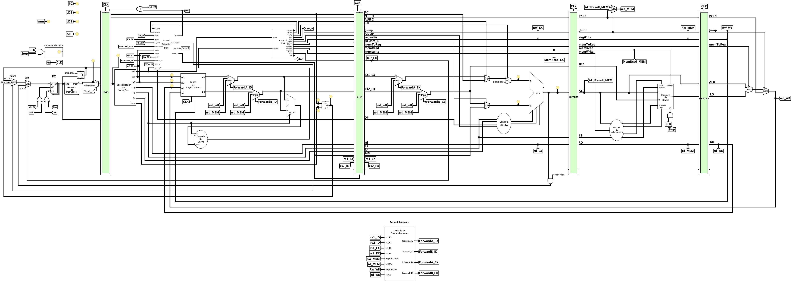

Português | [Español](README-es.md) | [English](README-en.md)

# Datapath - Pipeline com encaminhamento e bolhas automáticas



Implementação do processador RISC-V com **pipeline de 5 estágios** que resolve os conflitos de dados em hardware das duas formas descritas por Patterson e Hennessy (seção 4.7, _Data Hazards: Forwarding versus Stalling_):

- **Encaminhamento** (_forwarding_): o valor que uma instrução precisa é tirado do estágio em que ele já foi calculado, sem esperar a escrita no banco.
- **Bolhas automáticas**: quando o valor ainda não foi calculado em lugar nenhum, o circuito pausa a busca e a decodificação e insere uma bolha.

As bolhas só aparecem quando o encaminhamento não resolve o conflito: um _load_ seguido de uma instrução que usa o resultado e um desvio condicional que depende de uma instrução imediatamente anterior. É o _pipeline_ final do capítulo 4 do livro (figura 4.62), estendido às instruções da RV32I implementadas no projeto (aritméticas e lógicas, _loads_ e _stores_ de todos os tamanhos, os seis desvios, `jal`, `jalr`, `lui` e `auipc`).

A base é o [pipeline com bolhas](../pipeline_bubble/README.md): estágios, unidade de controle, tratamento de desvios e saltos, sinal `Stop` e bordas de _clock_ são os mesmos. O encaminhamento é o do [pipeline com encaminhamento](../pipelineEncaminhamento/README.md). Este manual descreve como as duas partes foram juntadas.

<br>

## O que muda em relação ao pipeline com bolhas

| Mudança | Estágio | Função |
| :--- | :---: | :--- |
| [`ucEncaminhamento`](../../componentes/pipelineComponentes/ucEncaminhamento/) | ID e EX | Gera `ForwardA_ID`, `ForwardB_ID`, `ForwardA_EX` e `ForwardB_EX` comparando `rs1`/`rs2` do ID e do EX com o `rd` das instruções no MEM e no WB. |
| MUXes `ForwardA_ID` e `ForwardB_ID` | ID | Na saída do banco: escolhem os operandos da `idULA` (desvios) e o que vai para o `ID/EX`. |
| MUXes `ForwardA_EX` e `ForwardB_EX` | EX | Na saída do `ID/EX`: escolhem os operandos da ULA e o dado do _store_. |
| MUX `wd_MEM` | MEM | Monta o valor que a instrução no MEM vai escrever: resultado da ULA ou `PC + 4` (`jal`/`jalr`). |
| [`ucConflitos`](../../componentes/pipelineComponentes/ucConflitos/) no lugar da `hazard_detection_unit` | ID | Mesmo lugar, mesmo bloco e mesmas ligações; pausa só nos casos que o encaminhamento não cobre. A lógica de desvios é a mesma. |
| [`estagioID_EX_bolha`](../../componentes/estagiosPipeline/estagioID_EX_bolha/) no lugar do `ID_EX_stage_bubble` | ID &rarr; EX | Mesma bolha (`Clear`), mais `rs1_EX` e `rs2_EX` para o encaminhamento no EX. |

A `ucConflitos` ocupa exatamente o lugar da `hazard_detection_unit`, com o mesmo bloco e os mesmos fios e túneis. As únicas mudanças em volta dela são as necessárias para as portas novas:

- o túnel `RW_MEM` que chegava à unidade virou `MemRead_MEM`;
- o bloco ficou 40 px mais alto para receber `MemRead_EX` (túnel) e `opcode_ID` (fio direto do `opcode`, que passa logo abaixo). Como ele passou a ocupar a linha por onde o fio do `PCSrc` chegava, o `PCSrc_ID` agora vai da unidade de controle até a unidade por túnel;
- a sonda da instrução no ID andou 30 px para a esquerda para dar lugar ao túnel `MemRead_EX`;
- os fios que já levavam `rs1` e `rs2` à unidade ganharam os túneis `rs1_ID` e `rs2_ID`, usados pelo `ID/EX` e pela `ucEncaminhamento`.

A `ucEncaminhamento` fica na parte de baixo do circuito, ligada só por túneis, como no `pipelineEncaminhamento`.

<br>

## Encaminhamento

O encaminhamento é igual ao do [pipeline com encaminhamento](../pipelineEncaminhamento/README.md#valores-encaminhados). Os quatro MUXes usam a codificação do livro:

| Seletor | Entrada do MUX | Túnel | Valor |
| :---: | :---: | :--- | :--- |
| `00` | 0 | — | Valor lido do banco (ID) ou guardado no `ID/EX` (EX). |
| `01` | 1 | `wd_WB` | Valor que o WB está escrevendo no banco (saída do MUX `Jump`). |
| `10` | 2 | `wd_MEM` | Valor que a instrução no MEM vai escrever (saída do MUX `wd_MEM`). |
| `11` | 3 | — | Nunca gerado; a entrada fica desconectada. |

```
EX:  ld1_EX ─► MUX ForwardA_EX ─► MUX Auipc ─► MUX Lui ─► ULA (A)
     ld2_EX ─► MUX ForwardB_EX ─┬─► MUX ALUSrcB ────────► ULA (B)
                                └─► EX/MEM (dado do store)

ID:  ld1 (banco) ─► MUX ForwardA_ID ─┬─► idULA (A)
                                     └─► ID/EX
     ld2 (banco) ─► MUX ForwardB_ID ─┬─► idULA (B)
                                     └─► ID/EX
```

- No EX é o encaminhamento clássico do livro (figuras 4.52 e 4.55). Como o MUX `ForwardA_EX` vem antes de `Auipc`/`Lui` e o `ForwardB_EX` antes de `ALUSrcB`, o `PC`, o `0` e o imediato continuam chegando à ULA nessas instruções. A base do `jalr` também é encaminhada, porque o alvo sai da ULA.
- No ID, os MUXes alimentam a `idULA`, que decide os desvios. O livro aponta que antecipar o desvio para o ID exige essa nova lógica de encaminhamento, com valores vindos do `EX/MEM` e do `MEM/WB` (seção 4.8).
- O MUX `wd_MEM` existe porque `jal` e `jalr` escrevem `PC + 4`, e não o resultado da ULA. Ele repete no MEM a escolha que o MUX `Jump` faz no WB.

### O caminho WB &rarr; ID
O banco grava na **subida** do _clock_ e os registradores de estágio na **descida** ([bordas de _clock_](../pipeline/README.md#bordas-de-clock)). Quando uma instrução está no WB e outra no ID, o banco já devolve o valor novo antes de o `ID/EX` capturá-lo, então a entrada `01` (`wd_WB`) dos MUXes do ID entrega o mesmo valor que o banco. Esse caminho é **redundante**, mas foi mantido:

- a `ucEncaminhamento` aplica a mesma regra aos dois estágios, e é o mesmo componente do `pipelineEncaminhamento`. Tirar o caminho exigiria uma unidade diferente só para o ID;
- não custa ciclo nenhum e não muda nenhum resultado;
- corresponde ao que o livro descreve para o ID, em que os operandos do desvio podem vir do `EX/MEM` **ou** do `MEM/WB`.

<br>

## Detecção de conflitos

A [`ucConflitos`](../../componentes/pipelineComponentes/ucConflitos/) pausa o _pipeline_ (`Stall = 1`) só quando o valor ainda não existe:

| Caso | Condição | Bolhas |
| :--- | :--- | :---: |
| _Load_ seguido de uso | `MemRead_EX` e `rd_EX ≠ 0` e `rd_EX` é lido pela instrução no ID | 1 |
| Escrita seguida de desvio | desvio condicional no ID e `RegWrite_EX` e `rd_EX ≠ 0` e `rd_EX` é lido pelo desvio | 1 |
| _Load_ seguido de desvio (2ª bolha) | desvio condicional no ID e `MemRead_MEM` e `rd_MEM ≠ 0` e `rd_MEM` é lido pelo desvio | +1 |

O primeiro é a condição do livro na seção 4.7; os outros dois são os da seção 4.8, que decide o desvio no ID. O `jalr` lê a base no EX e por isso só cai na regra do _load_. Como no `pipeline_bubble`, os sinais `read_rs1` e `read_rs2` evitam dependências falsas com campos que, em certas instruções, são parte do imediato.

Durante a pausa, como no livro:

1. O `PC` e o `IF/ID` mantêm seus valores (habilitação `NOT Stall OR Jalr_EX`).
2. `Bubble_ID` grava uma bolha no `ID/EX`, com todos os controles em `0`.
3. EX, MEM e WB continuam avançando até o valor ficar pronto para ser encaminhado.

<br>

## Desvios e saltos

Iguais aos do [pipeline com bolhas](../pipeline_bubble/README.md#desvios-e-saltos):

```text
Redirect_ID = PCSrc_ID AND NOT Stall AND NOT Jalr_EX
Flush_IF    = Redirect_ID OR Jalr_EX
Bubble_ID   = Stall OR Jalr_EX
```

| Situação | Comportamento |
| :--- | :--- |
| Desvio não tomado | Continua por `PC + 4`, sem descarte. |
| Desvio tomado ou `jal` no ID | Redireciona para `PC_ID + imm_ID` e descarta a instrução buscada: **1 bolha**. |
| Desvio com operando pendente | Espera no ID (ver [Detecção de conflitos](#detecção-de-conflitos)). |
| `jalr` no EX | Redireciona para o alvo da ULA e descarta IF e ID: **2 bolhas**. |

<br>

## Bolhas: medidas no circuito

Cada caso foi medido rodando o programa com e sem a dependência e contando a diferença de ciclos.

| Quem escreve &rarr; quem lê | Pipeline com bolhas | **Este _datapath_** |
| :--- | :---: | :---: |
| ULA &rarr; ULA | 2 | **0** |
| ULA &rarr; ULA, com 1 instrução entre elas | 1 | **0** |
| ULA &rarr; `sw` (dado ou base) | 2 | **0** |
| ULA &rarr; base do `jalr` | 2 | **0** |
| `jal` &rarr; uso do endereço de retorno | 1 | **0** |
| _Load_ &rarr; uso no EX (ULA, `sw`, base do `jalr`) | 2 | **1** |
| _Load_ &rarr; uso, com 1 instrução entre elas | 1 | **0** |
| ULA &rarr; desvio condicional | 2 | **1** |
| ULA &rarr; desvio, com 1 instrução entre elas | 1 | **0** |
| _Load_ &rarr; desvio condicional | 2 | **2** |
| _Load_ &rarr; desvio, com 1 instrução entre elas | 1 | **1** |
| Desvio tomado ou `jal` | 1 | **1** |
| `jalr` | 2 | **2** |
| Desvio não tomado | 0 | **0** |

> [!NOTE]
> Um _store_ logo depois de um _load_ que grava o valor lido (`lw x1` seguido de `sw x1`) também espera 1 ciclo, como no livro: o dado do _store_ é tratado como qualquer uso no EX.

<br>

## Sinais novos

| Túnel | Largura | Origem | Destino |
| :--- | :---: | :--- | :--- |
| `rs1_ID`, `rs2_ID` | 5 bits | Fios que levam `rs1`/`rs2` do decodificador à `ucConflitos` | `ID/EX` e `ucEncaminhamento` |
| `rs1_EX`, `rs2_EX` | 5 bits | `ID/EX` | `ucEncaminhamento` |
| `MemRead_EX` | 1 bit | `ID/EX` | `ucConflitos` |
| `MemRead_MEM` | 1 bit | `EX/MEM` | `ucConflitos` (no lugar do `RW_MEM`, que a unidade não usa mais) |
| `PCSrc_ID` | 1 bit | `control_unit_bubble` | `ucConflitos` (antes ia por fio) |
| `ALUResult_MEM` | 32 bits | `EX/MEM` | MUX `wd_MEM` |
| `wd_MEM`, `wd_WB` | 32 bits | MUX `wd_MEM` e MUX `Jump` | Entradas 2 e 1 dos quatro MUXes de encaminhamento |
| `ForwardA_ID`, `ForwardB_ID`, `ForwardA_EX`, `ForwardB_EX` | 2 bits | `ucEncaminhamento` | MUXes de encaminhamento |

A `ucEncaminhamento` também usa túneis que já existiam no `pipeline_bubble`: `rd_MEM`, `RW_MEM`, `rd_WB` e `RW_WB`.

<br>

## Testes

- **Unidades:** a `ucConflitos` passou em 26.736 vetores de teste e a `ucEncaminhamento` em 6.916 (combinações completas com registradores de `x0` a `x2` e combinações aleatórias com os 32 registradores).
- **Programas de [`codigos/`](../../codigos/):** a sequência de escritas no banco e na memória é idêntica à de um emulador da ISA e à do `pipeline_bubble`, com menos ciclos quando há dependências:

| Programa | Pipeline com bolhas | **Este _datapath_** |
| :--- | :---: | :---: |
| `fatorial` (sem `nop`) | 126 | **121** |
| `soma_vetor` (sem `nop`) | 73 | **52** |
| `teste_encaminhamento` | 242 | **136** |
| `teste_encaminhamento` (sem `nop`) | 238 | **132** |
| `teste_geral` (sem `nop`) | 521 | **265** |
| versões `_pipeline` (com os `nop` do pipeline simples) | igual | igual |

- **Programas aleatórios:** 60 programas de cerca de 170 instruções, sem nenhum `nop`, com todas as instruções implementadas e muitas dependências seguidas (inclusive _loads_ e desvios dependentes, `jal`, `jalr` e um laço): todos idênticos ao emulador.

<br>

## O que vem do livro e o que não vem

| Do livro (Patterson e Hennessy, cap. 4) | Específico deste projeto |
| :--- | :--- |
| Unidade de encaminhamento com as condições de `EX/MEM` e `MEM/WB`, `rd ≠ 0`, `RegWrite` e prioridade do `EX/MEM` (seção 4.7). | `rs1`/`rs2` lidos de verdade (`read_rs1`/`read_rs2`), para evitar pausas falsas com campos de imediato; desvio condicional reconhecido pelo `opcode` dentro da unidade. |
| Unidade de detecção de conflitos com a condição do _load_ e a bolha feita zerando os controles do `ID/EX` e congelando `PC` e `IF/ID` (seção 4.7, figuras 4.57 e 4.58). | Encaminhamento de `PC + 4` (MUX `wd_MEM`) para `jal`/`jalr`, que o livro não trata. |
| Desvio decidido no ID, com encaminhamento para a comparação e pausas de 1 ciclo após ULA e 2 após _load_ (seção 4.8). | `jalr` resolvido no EX, com descarte de IF e ID (2 bolhas) e prioridade sobre a pausa. |
| `IF.Flush` transformando a instrução buscada em `nop` no desvio tomado (seção 4.8). | Todos os desvios da RV32I (`beq` a `bgeu`) comparados na `idULA`, e não só igualdade. |
| Banco escrito na primeira metade do ciclo e lido na segunda (seção 4.7). | Bordas invertidas no Logisim (estágios na descida, banco e memória na subida) e o caminho WB &rarr; ID mantido por uniformidade. |
| | Sinal `Stop` para parar a simulação. |

<br>

## Arquivo

- **`main.circ`** — circuito completo do _datapath_ (abrir no Logisim-Evolution).
