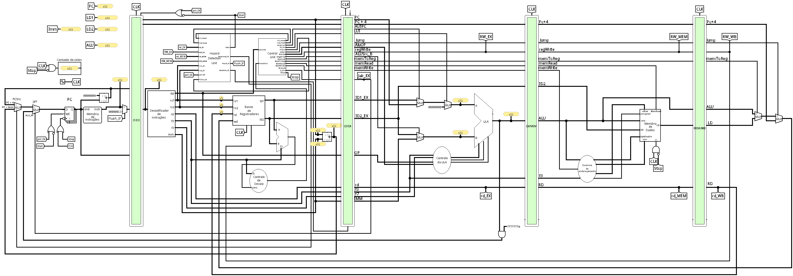

[Português](README.md) | Español | [English](README-en.md)

# Datapath - Pipeline con burbujas automáticas



Implementación del procesador RISC-V con **pipeline de 5 etapas** y **detección de riesgos de datos en hardware**. Como en el [pipeline simple](../pipeline/README.md), varias instrucciones se ejecutan simultáneamente. Cuando un operando todavía no está disponible, el circuito detiene la búsqueda y la decodificación e inserta burbujas automáticamente.

Esta versión del circuito **no implementa _forwarding_**: la instrucción dependiente espera a que el resultado se escriba en el banco de registros y las instrucciones del camino incorrecto se descartan tras las bifurcaciones y los saltos.

<br>

## Vista general de las etapas

| Etapa | Nombre | Función | Registro de salida |
| :---: | :--- | :--- | :---: |
| **IF** | _Instruction Fetch_ | Busca la instrucción en memoria y calcula el siguiente `PC`. | `IF/ID` |
| **ID** | _Instruction Decode_ | Decodifica, lee el banco de registros y resuelve las bifurcaciones. | `ID/EX` |
| **EX** | _Execute_ | Ejecuta la operación de la ALU (aritmética, dirección, destino de `jalr`). | `EX/MEM` |
| **MEM** | _Memory_ | Accede a la memoria de datos (`lw`/`sw` y variantes). | `MEM/WB` |
| **WB** | _Write-Back_ | Escribe el resultado en el banco de registros. | &mdash; |

<br>

## Etapa IF - Búsqueda de la instrucción

Busca la instrucción indicada por el `PC` y determina la dirección de la siguiente.

- **`PC` y [memoria de instrucciones](../../componentes/memInstrucoes/)** &mdash; proporcionan la instrucción actual y la dirección secuencial `PC + 4`.
- **Multiplexores del siguiente `PC`** &mdash; seleccionan la dirección secuencial, `PC_ID + imm_ID` mediante `Redirect_ID` o el destino de `jalr` calculado en EX. `jalr` tiene prioridad y su dirección recibe la máscara `0xFFFFFFFE`, que pone a cero el bit menos significativo.
- **[Registro `IF/ID`](../../componentes/estagiosPipeline/estagioIF_ID/)** &mdash; almacena la instrucción, `PC` y `PC + 4`. Cuando `Flush_IF = 1`, la instrucción recibida se sustituye por `0x00000013` (`nop`).

El `PC` y el `IF/ID` usan la habilitación `NOT Stall OR Jalr_EX`: permanecen congelados durante una dependencia, pero pueden avanzar para aplicar un `jalr` en EX. El [contador de ciclos](../../componentes/contadorCiclos/) sigue contando durante la espera.

<br>

## Etapa ID - Decodificación y control

La etapa con más componentes: decodifica la instrucción, lee los operandos y decide las bifurcaciones.

- **[Decodificador](../../componentes/decodificador/) y [banco de registros](../../componentes/bancoRegistradores/)** &mdash; extraen los campos de la instrucción y leen los operandos.
- **[Unidad de control](../../componentes/ucPrincipal/control_unit_bubble.circ)** &mdash; genera los controles de ejecución y `read_rs1`/`read_rs2`, que indican qué registros lee realmente la instrucción.
- **[Mini-ALU `idULA`](../../componentes/pipelineComponentes/idULA/) y [control de bifurcaciones](../../componentes/ucDesvio/)** &mdash; comparan los operandos para decidir las bifurcaciones condicionales. El destino de la bifurcación o de `jal` es `PC_ID + imm_ID`.
- **[Unidad de detección de riesgos](../../componentes/pipelineComponentes/hazard_detection_unit/hazard_detection_unit.circ)** &mdash; compara los registros fuente de ID con los registros destino de EX y MEM y genera las señales de pausa y descarte.
- **[Registro `ID/EX` con burbujas](../../componentes/estagiosPipeline/ID_EX_stage_bubble/ID_EX_stage_bubble.circ)** &mdash; recibe `Bubble_ID`, seleccionando datos y controles neutros para el siguiente flanco de bajada.

Las señales `read_rs1` y `read_rs2` evitan dependencias falsas con bits del inmediato y se activan según la siguiente tabla:

| Clase | `read_rs1` | `read_rs2` |
| :--- | :---: | :---: |
| Aritmética/lógica tipo R | 1 | 1 |
| Aritmética/lógica tipo I, cargas y `jalr` | 1 | 0 |
| Almacenamientos y bifurcaciones condicionales | 1 | 1 |
| `lui`, `auipc` y `jal` | 0 | 0 |

<br>

## Etapa EX - Ejecución

Realiza la operación aritmética/lógica principal.

- **Multiplexores de operandos** &mdash; seleccionan las entradas `A` y `B` de la ALU:
  - `A`: `rs1`, el `PC` (para `auipc`) o `0` (para `lui`).
  - `B`: `rs2` o el inmediato (`IMM`), según `ALUSrcB`.
- **[ALU](../../componentes/ULA/)** &mdash; ejecuta la operación (suma, resta, lógica, desplazamientos, comparaciones) y calcula las direcciones de carga/almacenamiento y el destino de `jalr` (`rs1 + imm`).
- **[Control de la ALU (`ucULA`)](../../componentes/ucULA/)** &mdash; decodifica `ALUOp`, `opcode`, `funct3` y `funct7` en `ALUControl` de 3 bits (siguiendo la codificación de `funct3`) y en dos selectores adicionales de la ALU: `subSeletor` (`add`/`sub`) y `sraiSeletor` (`srl`/`sra`).

<br>

## Etapa MEM - Acceso a memoria

Ejecuta las instrucciones de carga y almacenamiento.

- **[Memoria de datos](../../componentes/memDados/)** &mdash; usa el resultado de la ALU como dirección (`end.`) y `rs2` como dato que escribir (`ED`). Admite accesos de _byte_, media palabra y palabra, con lecturas con o sin signo.
- **[Control de direccionamiento (`ucEnderecamento`)](../../componentes/ucEnderecamento/)** &mdash; genera `byteEnable`, `size`, `offset` y `unsigned` a partir de `funct3` y la dirección, permitiendo `sb`/`sh`/`sw` y `lb`/`lh`/`lw`/`lbu`/`lhu`.
- `Stop` también bloquea el reloj de escritura de la memoria.

<br>

## Etapa WB - Escritura en el registro

Selecciona el valor que vuelve al banco de registros.

- **Multiplexor `MemToReg`** &mdash; elige entre el resultado de la ALU y el dato leído de memoria (`LD`).
- **Multiplexor `Jump`** &mdash; selecciona `PC + 4` como dirección de retorno de `jal`/`jalr`.
- El valor final entra en `wd`, con `rd` como dirección de escritura y `RegWrite` como habilitación.

<br>

## Señal `Stop`

La unidad de control genera `Stop` al encontrar un `opcode` no reconocido, como `0xFFFFFFFF`. La señal bloquea el reloj del `PC` (`CLK OR Stop`), de la memoria de datos y del contador (`CLK AND NOT Stop`).

> [!IMPORTANT]
> `Stop` no bloquea los registros de etapa ni el banco de registros. Deje suficientes ciclos para que las últimas operaciones terminen antes del marcador de fin, especialmente las escrituras en memoria.

<br>

## Dependencias y burbujas automáticas

Existe una dependencia cuando una instrucción en EX o MEM va a escribir un registro distinto de `x0` que la instrucción en ID necesita leer. En ese caso, **`Stall = 1`**:

1. El `PC` y el `IF/ID` mantienen sus valores.
2. `Bubble_ID` inserta una burbuja en `ID/EX`, desactivando las escrituras y los saltos.
3. EX, MEM y WB siguen avanzando hasta que el resultado esté disponible en el banco.

Por ejemplo, esta secuencia genera dos burbujas entre las instrucciones:

```asm
addi x1, x0, 5
add  x2, x1, x1
```

La `add` permanece en ID mientras la `addi` pasa por EX y MEM. Cuando la `addi` llega a WB, escribe `x1` y permite que la `add` avance con el valor actualizado. Lo mismo ocurre con una carga seguida inmediatamente por una instrucción dependiente.

> [!NOTE]
> `Flush_IF` sustituye la instrucción de IF por un `nop`. `Bubble_ID` selecciona datos y controles neutros en `ID/EX`, con `opcode = 0x13` y las señales de escritura y salto desactivadas.

<br>

## Bifurcaciones y saltos

Las siguientes señales controlan las pausas, la redirección y el descarte de instrucciones en el circuito.

```text
Redirect_ID = PCSrc_ID AND NOT Stall AND NOT Jalr_EX
Flush_IF    = Redirect_ID OR Jalr_EX
Bubble_ID   = Stall OR Jalr_EX
```

| Situación | Comportamiento |
| :--- | :--- |
| Bifurcación no tomada | Continúa por `PC + 4`, sin descarte. |
| Bifurcación tomada o `jal` en ID | Redirige a `PC_ID + imm_ID` y descarta IF: **1 burbuja**. |
| Bifurcación con operandos pendientes | Espera en ID hasta que se resuelva la dependencia. |
| `jalr` en EX | Redirige al destino calculado por la ALU y descarta IF e ID: **2 burbujas**, además de posibles esperas por datos. |

El `jalr` en EX tiene prioridad sobre la redirección en ID y sobre `Stall`.

<br>

## Registros de etapa y reloj

Los registros `IF/ID`, `ID/EX`, `EX/MEM` y `MEM/WB` propagan los datos y controles necesarios para las siguientes etapas.

El `PC` y los registros de etapa capturan los valores en el **flanco de bajada**; el banco de registros y la memoria de datos escriben en el **flanco de subida**. Así, WB puede escribir un valor antes de que ID lo capture en el mismo ciclo. Para más información, consulte [los flancos de reloj del pipeline simple](../pipeline/README.md#bordas-de-clock).
